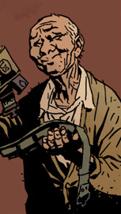

**Harry H. Middleton**[1] was a friend of [Trevor Bruttenholm](/entry/Trevor%20Bruttenholm) and [Hellboy](/entry/Hellboy). Hellboy stayed with him in England at the beginning of the *[Darkness Calls](/entry/Darkness%20Calls)* storyline.

## History

Harry Middleton was a friend of Bruttenholm and Hellboy. According to [Abe Sapien](/entry/Abe%20Sapien), he went to Eton College with Bruttenholm.[2] While attending Eton the pair encountered their first ghost near a Scottish monastery. He worked with them in the 1950's[3] on a number of cases including '[The Phantom Hand](/entry/The%20Phantom%20Hand) at St. Albans,' and 'The Braunton Burrows Hound'.[4]

### Death

Harry Middleton died in 1984.[5] Both Bruttenholm and Hellboy traveled to England to attend his funeral.[6]

Following Hellboy's time at sea (as seen in *[The Island](/entry/The%20Island)*), he stayed with Harry Middleton for one month,[7] before being taken to a gathering of witches (as seen in *[Darkness Calls](/entry/Darkness%20Calls)*). Harry, along with the ghosts of Sir Albert Lindsay and Lady Celia Radford, played cards with Hellboy two weeks before the events of *[Darkness Calls](/entry/Darkness%20Calls)*.[8] Harry also gave Hellboy a 1941 U.S. Army .45 in a left-handed holster, to replace Hellboy's lost gun.[9]

## Gallery

## Notes

<references/>

**Category:Male Characters** **Category:Deceased Characters** **Category:Humans** **Category:Spirits** **Category:British**

[1] His middle initial is given in "[The Mole](/entry/The%20Mole)"

[2] *[Darkness Calls](/entry/Darkness%20Calls)* epilogue 1

[3] *[Darkness Calls](/entry/Darkness%20Calls)* epilogue 1

[4] *[Darkness Calls](/entry/Darkness%20Calls)* \#1

[5] "[The Mole](/entry/The%20Mole)" & *[Darkness Calls](/entry/Darkness%20Calls)* epilogue 1

[6] *[Darkness Calls](/entry/Darkness%20Calls)* epilogue 1

[7] This is also mentioned in *[The Wild Hunt](/entry/The%20Wild%20Hunt)* \#1

[8] as seen in "[The Mole](/entry/The%20Mole)"

[9] *[Darkness Calls](/entry/Darkness%20Calls)* \#1