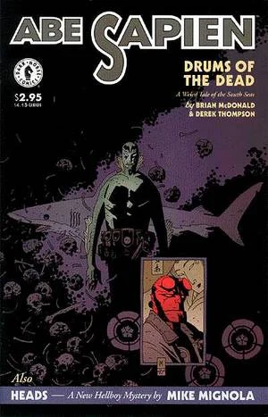

Hellboy travels Japan, and deals with Demons.

## Publication History

*Heads* was originally published as the backup to *[Abe Sapien: Drums of the Dead](/entry/Drums%20of%20the%20Dead)* in March 1998. In April 2000, the story was collected in [*Hellboy – Volume 4: The Right Hand of Doom*](/entry/TPB).

## Synopsis

In Kyoto, Japan, 1967, [Hellboy](/entry/Hellboy%20%28character%29) is investigating a rumor of an "evil house" next to a local lake there where something terrible happened that drove the local population away from it and caused the village around it to fall to ruin. It is said that demons live in the house. Hellboy sleeps on a road in the woods nearby one night and is woken up by a local man. The man tells Hellboy it is too dangerous to sleep in the woods, citing the bad things that come out at night.

The man invites Hellboy to his home, the so-called evil house. There, Hellboy is introduced to the homeowner's five guests, who are said to be travelers and good people. Hellboy eventually excuses himself from the common room after the guests make a disturbing joke. Hellboy, mistrusting the homeowner and the guests, waits until the house has quieted, draws his gun and proceeds to investigate the house.

Hellboy finds six headless bodies, those of the homeowner and his guests. The bodies are completely clean, in a neat sitting position, and without a drop of spilled blood in the area. Hellboy, suspecting supernatural powers at play, drags the bodies outside, ties them together, weighs them down with a stone lantern, and throws them into the lake. He then continues to look for their heads.

Hearing whispers from the nearby woods and following them, Hellboy watches the heads from a distance. The homeowner and his guests are all demons, seeking to devour Hellboy. When the homeowner floats to the house to check whether Hellboy is asleep, he discovers that all of their bodies have been taken, and, in shock, hurriedly informs his compatriots. They panic, fearing they shall not be able to reconnect to their bodies before sunrise.

Hellboy rushes out from cover, shoots the homeowner's head, then confronts the others. The demons attack and attempt to interrogate Hellboy, but he is able to subdue them until the rising sun destroys them.

## Sword of Storms

A version of this story was incorporated into the [animated](/entry/Hellboy%20Animated) film, [Hellboy: Sword of Storms](/entry/Hellboy__Sword_of_Storms). This version is very similar to the comic, but takes place in modern times, and not in the 60s.

! colspan = 3 | [*Hellboy – Volume 4: The Right Hand of Doom*](/entry/TPB)

**Category:Story** **Category:Hellboy story**