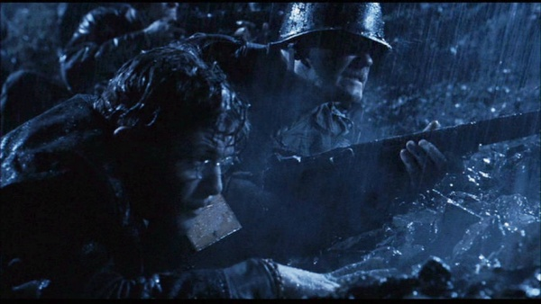

***Hellboy*** is a supernatural action-thriller based on the Dark Horse Comics work *[Hellboy: Seed of Destruction](/entry/Seed%20of%20Destruction)* by [Mike Mignola](/entry/Mike%20Mignola). The film was produced by Revolution Studios and distributed by Columbia Pictures. A sequel, *[Hellboy II: The Golden Army](/entry/Hellboy_II__The_Golden_Army)*, was released on July 11, 2008.

## Cast

- Ron Perlman: [Hellboy](/entry/Hellboy%20%28character%29)
- Selma Blair: [Liz Sherman](/entry/Liz%20Sherman)
- Ladislav Beran: [Kroenen](/entry/Karl%20Ruprecht%20Kroenen)
- [Doug Jones](/entry/Doug%20Jones): [Abe Sapien](/entry/Abe%20Sapien)
- John Hurt: [Professor Trevor Bruttenholm](/entry/Trevor%20Bruttenholm)
- [Rupert Evans](/entry/Rupert%20Evans): [John Myers](/entry/John%20Myers)
- Karel Roden: [Grigori Rasputin](/entry/Grigori%20Rasputin)
- Jeffrey Tambor: Tom Manning
- Bridget Hodson: Ilsa von Haupstein
- David Hyde Pierce: [Abe Sapien](/entry/Abe%20Sapien) *(voice, uncredited)*
- Corey Johnnson: Agent Clay
- William Hoyland: [Klaus Werner von Krupt](/entry/Klaus%20Werner%20von%20Krupt)
- Angus Maclnnes: [George Whitman](/entry/George%20Whitman)

## Plot

In 1944, Russian mystic [Grigori Rasputin](/entry/Grigori%20Rasputin) works with a team of German Nazis lead by [Klaus Werner von Krupt](/entry/Klaus%20Werner%20von%20Krupt) to build a dimensional portal, which he intends to use to bring about the destruction of Earth by awakening the [Ogdru Jahad](/entry/Ogdru%20Jahad) , monstrous entities that have been imprisoned and asleep for an undisclosed time. He is aided by his servant and lover, Ilsa von Haupstein, to whom he has granted eternal life, and Colonel [Karl Ruprecht Kroenen](/entry/Karl%20Ruprecht%20Kroenen), a notorious assassin. The United States sends a team to destroy the portal, guided by a young doctor, [Professor Trevor Bruttenholm](/entry/Trevor%20Bruttenholm), who is well-versed in terms of magic and sorcery, along with [George Whitman](/entry/George%20Whitman). In the ensuing battle, the portal is destroyed, killing Rasputin. Ilsa and Kroenen escape capture. As the USA team survey the ruins for anything that may have snuck into their dimension through the portal, they discover a bright red infant demon with a right hand seemingly made from stone. Bruttenholm coaxes it into his arms with a Baby Ruth candy bar. They name the little demon "[Hellboy](/entry/Hellboy%20%28character%29)." Sixty years later, a young FBI agent named [John Myers](/entry/John%20Myers) is transferred to the [Bureau for Paranormal Research and Defense](/entry/Bureau%20for%20Paranormal%20Research%20and%20Defense), which is run by Professor Bruttenholm. He is introduced to Hellboy, now an adult. Also employed with the BPRD is a fish-like being named [Abe Sapien](/entry/Abe%20Sapien), who has very advanced psychic abilities, and [Liz Sherman](/entry/Liz%20Sherman), a pyrokinetic who has yet to learn to control her firestarting abilities, and a human agent, Agent Clay. Liz has recently quit the bureau (for the thirteenth time) and checked herself into a mental hospital in an effort to protect others from herself. Despite regular visits and coaxing from Hellboy, she is determined not to return this time. Meanwhile, Kroenen and Ilsa resurrect Rasputin. Rasputin and his companions travel to New York and the Machen Library of Paranormal Artifacts. There, they release a demon known as [Sammael](/entry/Sammael), a hellhound with a distinct insectoid appearance. Rasputin imbues Sammael with the power to reincarnate and split his essence, creating two more Sammael demons each time one dies. Rasputin then visits Liz as she sleeps, subconsciously reactivating her powers, causing the near-total destruction of the hospital. Afterwards, Myers visits her and convinces her to return to the bureau, at least in the short term. The multiplying Sammael quickly becomes a major problem, as Hellboy repeatedly kills it, creating dozens more. Sapien is injured during an attempt to retrieve some of their eggs, and Kroenen kills three of the human agents sent with him, including Clay. Kroenen, whose ancient body is now run by mechanisms, then shuts himself down and pretends to be defeated just before Hellboy arrives. Kronen's 'corpse' is brought to the bureau for examination. Director Tom Manning is angered by Hellboy's recklessness, which is indirectly responsible for the agents' deaths. Hellboy gets mad and threatens Manning just as Liz returns, almost causing her to leave again just as quickly. Myers, in an effort to help her overcome her difficulties with Hellboy, offers to take her out for coffee. Hellboy, jealous, covertly follows them. While they are away, Rasputin appears at the bureau, reanimating Kroenen before they confront Professor Bruttenholm. Out of twisted respect for Bruttenholm's protection and nurturing of Hellboy, Rasputin promises him a quick death, but first offers him a vision of the future, showing Hellboy has destroyed the world. Rejecting Rasputin's vision of Hellboy's destiny, Bruttenholm is stabbed in the neck and collapses, clutching a rosary, and dies. Manning takes over the BPRD and, with the help of Hellboy and the others, manages to find Rasputin based at a mausoleum outside Moscow, Russia. An enraged Hellboy destroys Kroenen once and for all, to avenge the death of his "father", Professor Bruttenholm. Meanwhile Liz, with some help from Myers, lets go of the fear that has prevented her from unleashing her full potential and uses her pyrokinetic powers to encase herself in blue fire, which she uses to incinerate the army of Sammaels. Unfortunately, the effect renders Hellboy, Liz, and Myers unconscious. To get Hellboy to release the Ogdru Jahad, Rasputin sucks Liz's soul out of her body, telling Hellboy that Liz will come back to life if he complies. Hellboy, not wanting to lose Liz, awakens his true power as [Anung un Rama](/entry/Hellboy%20%28character%29) (the Beast of the Apocalypse), causing his horns to regrow. He nearly releases the Ogdru Jahad, but Myers reminds him of who he is and that he has the right to choose his own path. He snaps off his horns, returning to his former self and resealing the Ogdru Jahad. As Rasputin screams his disappointment at Hellboy, Hellboy stabs him with one of his broken horns. However, Rasputin has one last trick up his sleeve: he is possessed by a demon from the Ogdru Jahad. The Behemoth bursts out of Rasputin's body, grows to immense size, and destroys Rasputin and Ilsa. Hellboy grabs a stone sword from a nearby statue and attacks the Behemoth's tentacles, then allows himself to be swallowed with a live band of hand grenades. The Behemoth dies in the resulting explosion. Liz's vital signs are gone when Hellboy returns from the fight, but he whispers into her ear and suddenly her life is restored. When she asks how her soul was returned, Hellboy replies that he simply told the creatures from the other side the cost of taking her: "Hey, you on the other side. Let her go. Because for her I'll cross over, and then you'll be sorry." She and Hellboy kiss as she surrounds them in blue flame and the narrator, Myers, says that what truly makes a man is "Not how he starts things, but how he decides to end them." Finally, the film ends with a humorous mid-credits scene, where a forgotten and frightened Manning is lost in the mausoleum, looking to see if there's anyone around.

## Trivia

  
During the opening sequence of the film, Sgt. Whitman and several other soldiers use M1 Garands.  

## References

## External links

- [Hellboy](http://www.imdb.com/title/tt0167190/) at IMdB.com
- [Hellboy](http://www.allmovie.com/cg/avg.dll?p=avg&sql=1:287448) at allmovie.com
- [Hellboy](http://www.rottentomatoes.com/m/hellboy/) at rottentomatoes.com
- [Hellboy Hype!](http://www.superherohype.com/hellboy/) at superhero hype!
- [*Hellboy* film official site](http://www.sonypictures.com/movies/hellboy/)
- [*Hellboy* official site](http://www.hellboy.com/)
- [The Doug Jones Experience *Hellboy* film page](http://www.thedougjonesexperience.com/Hellboy.htm) \*[Hellboy](http://flaregamer.com/b2article.php?p=89&more=1) at FLAREgamer
- [Screenplay - Production Draft](http://sfy.ru/sfy.html?script=hellboy)
- [Hellboy](http://www.fanhistory.com/wiki/Hellboy) at FanHistory
- [Detailed Comparison between Theatrical release (PG-13) and Director's Cut](http://www.movie-censorship.com/report.php?ID=1905&In=WikE)

## Awards

### Won

- **Image Award, 2004**
  - Best Director - Feature Film.
- **Saturn Award, 2005**
  - Best Make-Up.

### Nominated

- **Teen Choice Award, 2004**
  - Choice Movie - Drama/Action Adventure.
- **VES Award, 2005**
  - Outstanding Performance by an Animated Character in a Live Action Motion Picture.
- **IHG Award, 2005**
  - Best Movie.
- **Bram Stoker Award, 2005**
  - Screenplay.
- **Saturn Award, 2005**
  - Best Fantasy Film.
  - Best Special Edition DVD Release.
  - Best Costumes.

### Trailers

- \[<http://www.sonypictures.com/cthe/hellboy/helltrailer_high.asx>? First Trailer\]
- [Second trailer](http://www.sonypictures.com/movies/hellboy/video/trailer2/trailer2_high.asx?affiliateId=)

de:Hellboy (2004)

**Category:Hellboy (2004 film)** **Category:Films**