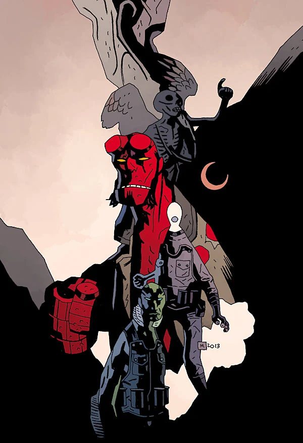

A sampler created for the 20th Anniversary celebrations on "Hellboy Day", March 22nd, 2014.

## Publication History

This issue reprints the stories *[The Ghoul](/entry/The%20Ghoul)* and *[Another Day at the Office](/entry/Another%20Day%20at%20the%20Office)*, and prints here for the first time *[The Coffin Man](/entry/The%20Coffin%20Man)*, a story with Hellboy set in Mexico, 1956 with art by [Fábio Moon](/entry/F%C3%A1bio%20Moon), and a series of parody comic strips, *B.P.R.D. Color Comics Fun!*, by [R. Sikoryak](/entry/R.%20Sikoryak).

**Category:Comics**