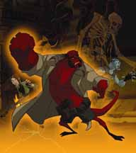

 ***Hellboy Animated*** is a pair of original straight-to-DVD animated films based on the [*Hellboy* comic book series](/entry/Hellboy%20%28series%29). The two films, *[Sword of Storms](/entry/Hellboy__Sword_of_Storms)* and *[Blood and Iron](/entry/Hellboy__Blood_and_Iron)*, were made with the approval of [Mike Mignola](/entry/Mike%20Mignola) and [Guillermo del Toro](/entry/Guillermo%20del%20Toro). A third film was being planned, but has since been abandoned.

## Cast

Ron Perlman, who played [Hellboy](/entry/Hellboy%20%28character%29) in the [live-action movie](/entry/Hellboy%20%28film%29), also provides the voice of the character in the animated version. Selma Blair and John Hurt also reprise their roles from the film of [Liz Sherman](/entry/Liz%20Sherman) and Professor [Trevor Bruttenholm](/entry/Trevor%20Bruttenholm), respectively. The voice of [Abe Sapien](/entry/Abe%20Sapien) is Doug Jones, who played Abe in prosthetic work in the live-action movies, but did not provide the voice in the first movie which was previously done by David Hyde Pierce. Kate Corrigan is voiced by Peri Gilpin.

Music is by Christopher Drake.

## Films

### *Sword of Storms*

In *Sword of Storms*, Hellboy and [Kate Corrigan](/entry/Kate%20Corrigan) are dispatched to Japan to solve the mystery of a professor possessed by the Japanese demons Thunder and Lightning. The demons wish to get their hands on a powerful haunted sword, which will free them, and allow them to unleash their [brothers](/entry/Ogdru%20Jahad) and destroy the world. While Hellboy is sent into an alternate dimension, facing Youkai on the way, his [B.P.R.D.](/entry/B.P.R.D.) teammates, Abe Sapien and Liz Sherman, try to stop one of the Dragons on the first wave of the coming chaos.

### *Blood and Iron*

*Hellboy: Blood and Iron* deals with Professor Trevor Bruttenholm's experience with a vampiress (the blood countess) in 1934 and the present day. Hellboy also faces off against Hecate. The DVD for this also includes a bonus short called *Hellboy: Iron Shoes*.

### *The Phantom Claw*

The abandoned third film. It was to be the debut of [Lobster Johnson](/entry/The%20Lobster) in the series, though it was to primarily feature Hellboy and Kate.

On March 19, 2008, a message was posted on the *Hellboy Animated* site by producer Tad Stones stating that no work is being done on this film. However, Stones also wrote that some smaller animated projects may be done for internet release, and hinted that the release of *[Hellboy II: The Golden Army](/entry/Hellboy_II__The_Golden_Army)* may affect the future of the animated film series.

All work on *The Phantom Claw* has since been suspended indefinitely.

## Comics

Dark Horse released a number of volumes under the *Hellboy Animated* range. These continue the adventures of the animated characters.

- *Hellboy Animated*:
  - *Phantom Limbs* (October 2006, included with *Sword of Storms* DVD, written by Jim Pascoe with art by Rick Lacy)
  - *The Black Wedding* (80 pages, January 2007, ISBN 1-59307-700-9) contains:
    - "The Black Wedding" (written by [Jim Pascoe](/entry/Jim%20Pascoe) with art by Rick Lacy)
    - "Pyramid of Death" (written by Tad Stones with art by Fabio Laguna)
  - *The Yearning* (May 2007, written by Jim Pascoe with art by Ben Stenbeck)
  - *Judgment Bell* (80 pages, June 2007, ISBN 1-59307-799-8) contains:
    - "The Judgment Bell" (written by Jim Pascoe with art by Rick Lacy)
    - "The Menace of the Mechanical Monster" (written by Tad Stones)
  - *The Menagerie* (80 pages, December 2007, ISBN 1-59307-861-7) contains:
    - "The Menagerie" (written by Jason Hall with art by Rick Lacy)
    - "Small Victories" (written by Nate Piekos with art by Fabio Laguna)

## Merchandise

Gentle Giant, famed for its statues, has been given the license for the Hellboy Animated action figures. A first-look Hellboy figure shrinkwrapped to a copy of the Blood and Iron DVD was released as a Best Buy exclusive.

## External links

- [Official *Hellboy Animated* production blog](http://hellboyanimated.typepad.com/)

**Category:Hellboy Animated** **Category:Comics**