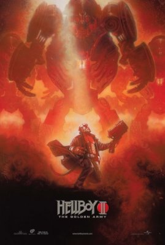

***Hellboy II: The Golden Army*** is a sequel to the 2004 movie *[Hellboy](/entry/Hellboy%20%282004%20film%29)*. Universal Pictures finances and distributes the film, which has a target release date for July 11, 2008. The Film is Rated PG-13 for sequences of Sci-fi action and violence and some language.

## Plot

In the Christmas of 1955, a young [Hellboy](/entry/Hellboy%20%28character%29) is told a bedtime story by [his father](/entry/Trevor%20Bruttenholm), involving an ancient battle between humans and the Mythical Creatures. Humanity once had a hollow heart that only lusted for war. A Goblin approached King Balor, offering the creation of an army, controlled by a [crown](/entry/Crown%20of%20Bethmora) that would give its wearer control over an unstoppable clockwork army. The king was convinced by his son [Nuada](/entry/Nuada) to take the offer. The 4900 soldiers, called [The Golden Army](/entry/The%20Golden%20Army), decimated the humans so completely that a truce was made. Humans would have the cities, while the mythical creatures would have the forests. The crown was broken, with two parts going to the elves and one to the humans. Nuada was so furious that he went into self-imposed exile. The Golden Army was buried and quickly became legend.

In the present, the now-adult Hellboy is having relationship issues with his girlfriend [Liz](/entry/Liz%20Sherman). The duo, along with their partner [Abe Sapien](/entry/Abe%20Sapien), are sent to an auction house where violence has erupted. Unbeknownst to them, The King of the Elves has been murdered by his son [Nuada](/entry/Nuada), who has taken it upon himself to destroy mankind. After taking his father's piece of the crown, he unleashed thousands of Tooth Fairies in the auction house, which devoured everyone and allowed him access to the second piece of the crown.

Abe scans the auction house, but accidentally scans Liz and discovers she's pregnant. She denies it, but Abe assures her he is never incorrect. After a fierce, fiery battle with the fairies, Hellboy is blown out a window and exposed to the media, thus destroying the secrecy of the [BPRD](/entry/Bureau%20for%20Paranormal%20Research%20and%20Defense). Furious at his actions, the Washington branch sends down a new agent, [Johann Kraus](/entry/Johann%20Kraus), a being of complete ectoplasm encased in a special suit, who works completely by the book.

The group then travels to The Troll Market, an enormous city hidden under the Brooklyn Bridge, for clues. While Hellboy and Johann question various creatures on the purchase of Tooth Fairies, Abe eventually discovers Princess Nuala, who holds the last piece of the crown needed to control the Golden Army. She receives a canister that contains a map that gives the location of the resting place of the Golden Army from one of her father's friends. As they prepare to depart, they are attacked by [Mr. Wink](/entry/Mr.%20Wink). Hellboy comes to their rescue and defeats Wink, allowing everyone to leave the Troll Market. As they emerge, they are confronted by Nuada, who is angry over the loss of his friend. He then summons a giant Forest God to attack the agents and wreak havoc on the city. Hellboy eventually defeats the creature with the use of a special gun called "Big Baby", while simultaneously saving the life of an infant. When Hellboy returns the infant to its mother, she accuses him of harming it and the crowd turns violent against him. Liz shouts at the crowd telling them that they've been trying to protect them, but all to no avail. As she becomes enraged, her flames begin to burn ominously, silencing the crowd. But Hellboy calms her down and says that they should just go home. The agents take Nuala into captivity at BPRD headquarters, where Abe quickly falls in love with her.

When Prince Nuada discovers his sister's location, he attacks BPRD headquarters. Nuala, sensing her brother's presence, hides the final piece of the crown in one of Abe's books and tries to throw the canister into the fireplace. However, he discovers the canister, retrieves it from the fire, and rolls it on a wooden desk, burning a map onto its surface. While he tries to look for the crown piece, the BPRD agents arrive to try and stop him. When Hellboy attempts to attack the prince, he stabs him in the chest with an spear and breaks off the head, leaving it in Hellboy's chest. Nuada demands the crown piece in exchange for Nuala. As he collapses, Nuada departs with Nuala. Abe and Liz take Hellboy to the infirmary, where they try to remove the spearhead from his chest, but every time they get near it, the shard moves closer to his heart.

After analyzing the map, Liz, Johann, and Manning discover that the resting Bethmoora is located in County Antrim, Northern Ireland. When Liz suggests that they leave immediately, Manning and Johann tell her that they are under orders from Washington not to hand over the crown piece. When Liz protests that Hellboy will die, Johann tells her that if the Golden Army is awakened, millions will die. Liz accuses Johann of losing touch with his humanity and storms off. Meanwhile, Abe, while remembering a book that Nuala was reading, finds the missing crown piece in the library, but doesn't let Manning know.

He tells Liz and arranges for them to take a plane in the hangar. En route to the hangar, they are stopped by Johann, who offers to help them.

The four of them travel to Northern Ireland, where the Golden Army was buried millennia ago, to confront their foe. They meet the Goblin who built the Army, who wants the shard in Hellboy's chest in exchange for passage to Bethmoora. He takes them to the [Angel of Death](/entry/Angel%20of%20Death), the only one who can remove it safely. The Angel lets Liz decide whether or not Hellboy should live, but warns her that if Hellboy lives he will bring about apocalypse and Liz would suffer the most. Liz accepts the consequences and the Angel removes the shard but tells Liz she must give him a reason to live. Liz whispers into Hellboy's ear, informing him that he is going to be a father.

Meanwhile, Abe has found the last piece of the crown that Nuala hid and gives it up to Prince Nuada in exchange for her life. He forms the crown and awakens the golden army, which immediately attacks the agents. After a fierce battle, they realize that the army cannot be destroyed, as all of their damage regenerates and their parts reassemble themselves.

Hellboy challenges Nuada for the right to the crown, which the Prince is forced to accept, given that Hellboy, son of the Fallen One, is royalty in Hell. They duel, but Abe informs Hellboy that he cannot kill Nuada, for the Prince and Princess are shared-soul twins - and when one is injured, they both share the wounds. Hellboy defeats Nuada, but the latter tells him he must be killed, as he will never stop fighting. Hellboy refuses and the Prince tries to attack once more, when suddenly, blood pours from his chest. His sister has stabbed herself through the heart, killing them both.

Abe rushes to Nuala's body and tells her he loves her before she dies. As she does, he cries for the first time in his life. Liz incinerates the crown, shutting down The Golden Army forever.

As the BPRD agents leave the underground city Agent Manning reprimands them for their actions. To his surprise, Hellboy, Liz, and Abe all hand over their belts (although Hellboy keeps the Samaritan) and announce their resignation from the bureau. He complains to Johann, who then insults Manning and walks off defiantly with his new-found friends. As they walk away, Hellboy muses about his child. Liz corrects him by putting up two fingers - indicating twins.

## Cast

- Ron Perlman: [Hellboy](/entry/Hellboy%20%28character%29)
- Selma Blair: [Liz Sherman](/entry/Liz%20Sherman)
- [Doug Jones](/entry/Doug%20Jones): [Abe Sapien](/entry/Abe%20Sapien), The [Angel of Death](/entry/Angel%20of%20Death), The Chamberlain, Wizard[1]
- Jeffrey Tambor: Tom Manning
- John Hurt: [Trevor Bruttenholm](/entry/Trevor%20Bruttenholm)
- [Luke Goss](/entry/Luke%20Goss): [Prince Nuada](/entry/Nuada)
- Anna Walton: [Princess Nuala](/entry/Nuala)
- John Alexander: [Johann Kraus](/entry/Johann%20Kraus) [2]
- Seth MacFarlane: [Johann Kraus](/entry/Johann%20Kraus) *(voice)*[3]
- Roy Dotrice: King Balor[4]
- Brian Steele: Cronie Troll, [Mr. Wink](/entry/Mr.%20Wink), Map Shop Owner, Fragglewump[5]

## Production

In May 2004, the sequel to *[Hellboy](/entry/Hellboy%20%282004%20film%29)* entered development at Revolution Studios with the first film's writer-director [Guillermo del Toro](/entry/Guillermo%20del%20Toro) returning with producers Lawrence Gordon, Mike Richardson, and Lloyd Levin. The comic book creator of Hellboy, [Mike Mignola](/entry/Mike%20Mignola), was asked to develop a story with del Toro for the sequel, with actor Ron Perlman to reprise the role of Hellboy.[6] The following September, del Toro expressed interest in making *Hellboy* into a trilogy with Mignola, with the first sequel slated for a 2006 release.[7]

In August 2006, *Hellboy II* was orphaned by then-defunct Revolution Studios, and Universal Pictures acquired the project to be slotted for a summer 2008 release. Production was slated to begin in April 2007 in Budapest and London.[8] del Toro, who had been in negotiations to film *Halo*, instead chose to stay with *Hellboy II* for "artistic and personal reasons."[9] In October 2006, del Toro shared his plan to recreate the classic versions of Frankenstein, Dracula and The Wolf Man.[10] The director also reiterated plans for a third *Hellboy* to create a trilogy.[11]

With the success of del Toro's *Pan's Labyrinth*, the director was able to fast-track production of the sequel to *Hellboy*.[12] Guillermo del Toro began filming *Hellboy II* in June 2007 in Budapest and concluded in December 2007.[13] The official trailer for *Hellboy II* was made available on Thursday, December 20th.

In February 2007, Mignola described the story he had developed with del Toro as one that focused on folklore and fairy tales, rather than the more pulp elements of the first film.

## Trivia

- Doug Jones is rumored to have done all his own stunts for this movie. This was attributed to his athletic ability in gymnastics.
- Neil Gaiman spent several days on the set of *[Hellboy II: The Golden Army](/entry/Hellboy%20II%3A%20The%20Golden%20Army)* to get pointers on directing from [Guillermo del Toro](/entry/Guillermo%20del%20Toro) for use in his own upcoming directorial debut, *Death and Me*.[14]

## References

<references />

## External links

- [Official site and trailer](http://www.hellboymovie.com/)
- [Hellboy II: The Golden Army](http://www.imdb.com/title/tt0411477/) at IMdB.com

de:Hellboy – Die goldene Armee

**Category:Hellboy II: The Golden Army** **Category:Films**

[1] [*Pan's Labyrinth* Duo Use Oscar Clout To Make *Hellboy II* Their Way](http://www.vh1.com/movies/news/articles/1552289/20070212/story.jhtml) Larry Carroll, vh1, 2007-02-13

[2] [Del Toro Films - Guillermo Del Toro Fansite - GDT Announces *Hellboy 2* Cast](http://www.deltorofilms.com/Details.php?announcementid=552)

[3] [Update: Del Toro on The Hobbit, Hellboy II & New Project](http://www.comingsoon.net/news/nycomicconnews.php?id=44244)

[4]

[5]

[6] ['Hellboy II'' Confirmed!](http://movies.ign.com/articles/515/515970p1.html) Stax, ign.com, 2004-05-14

[7] [Guillermo, Blair Talk *Hellboy* Sequel](http://movies.ign.com/articles/544/544125p1.html) Brian Linder, ign.com, 2004-09-02

[8] ['Hellboy' in U turn](http://www.variety.com/article/VR1117947953.html?categoryid=1350&cs=1) Michael Fleming, *Variety*, 2006-08-03

[9] [Tyro helmer wears 'Halo'](http://www.variety.com/article/VR1117948239.html?categoryid=1236&cs=1) Gabriel Snyder, *Variety*, 2006-08-09

[10] [Exclusive: Hellboy vs. the Universal Monsters?](http://movies.ign.com/articles/739/739203p1.html) Scott Collura, ign.com, 2006-10-16

[11] [Exclusive: *Hellboy 2* Leads to *Hellboy 3*](http://movies.ign.com/articles/739/739228p1.html) Scott Collura, ign.com, 2006-10-16

[12]

[13] [‘HELLBOY 2’ UPDATE](http://www.wizarduniverse.com/magazine/wizard/005779781.cfm) Andy Serwin, Wizard Entertainment, 2007-08-28

[14] [Del Toro Wants Gaiman On *Death*](http://www.scifi.com/scifiwire/index.php?category=0&id=45051)