In addition to [the comics](/entry/Hellboy%20%28series%29), the Hellboy Universe is also explored in a line of prose novels.

## Prose Novels

<table>
<thead>
<tr class="header">
<th>
Title
</th>
<th>
Date Published
</th>
<th>
Author/s
</th>
<th>
Cover
</th>
</tr>
</thead>
<tbody>
<tr class="odd">
<td>
<em><a href="Hellboy:_The_Lost_Army" title="wikilink">Hellboy: The Lost Army</a></em>
</td>
<td>
June 1, 1997
</td>
<td>
Christopher Golden 
<em>with illustrations by</em> 
Mike Mignola
</td>
<td>
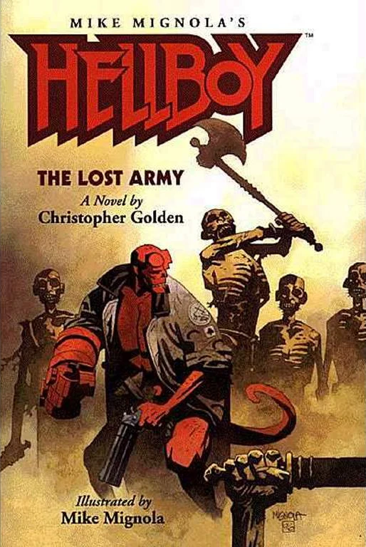<em>by</em> Mike Mignola
</td>
</tr>
<tr class="even">
<td>
<em><a href="Hellboy:_The_Bones_of_Giants" title="wikilink">Hellboy: The Bones of Giants</a></em>
</td>
<td>
December 5, 2001
</td>
<td>
Christopher Golden 
<em>with illustrations by</em> 
Mike Mignola
</td>
<td>
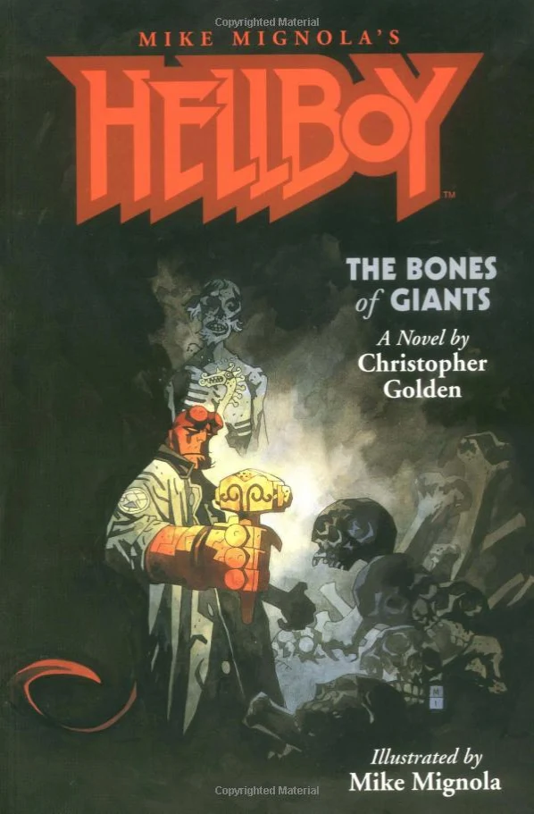<em>by</em> Mike Mignola
</td>
</tr>
<tr class="odd">
<td>
<em><a href="Hellboy:_On_Earth_as_it_is_in_Hell" title="wikilink">Hellboy: On Earth as it is in Hell</a></em>
</td>
<td>
September, 2005
</td>
<td>
Brian Hodge
</td>
<td>
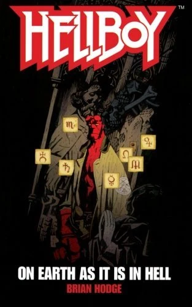<em>by</em> Mike Mignola
</td>
</tr>
<tr class="even">
<td>
<em><a href="Hellboy:_Unnatural_Selection" title="wikilink">Hellboy: Unnatural Selection</a></em>
</td>
<td>
March, 2006
</td>
<td>
Tim Lebbon
</td>
<td>
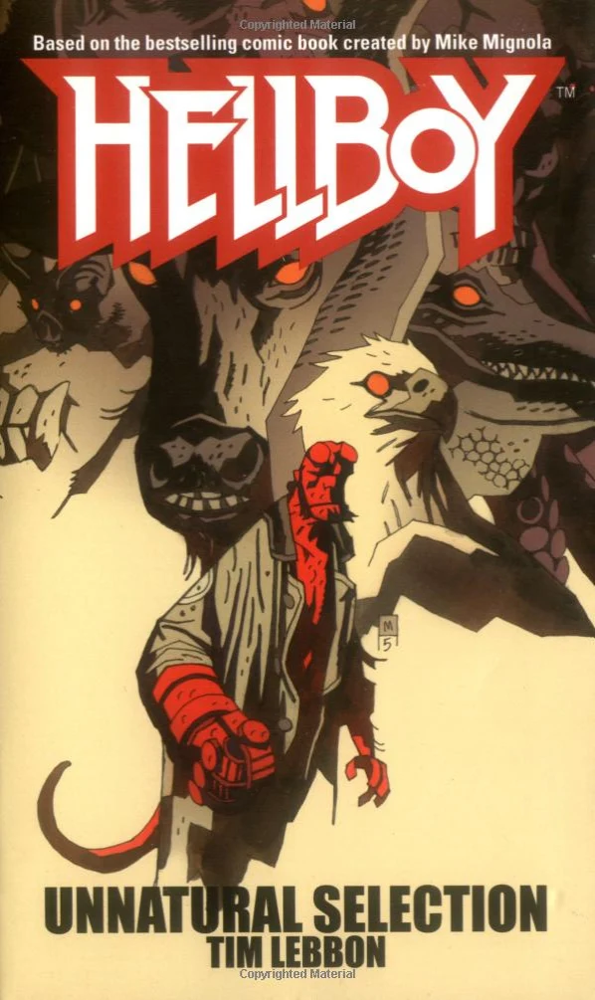<em>by</em> Mike Mignola
</td>
</tr>
<tr class="odd">
<td>
<em><a href="Hellboy:_The_God_Machine" title="wikilink">Hellboy: The God Machine</a></em>
</td>
<td>
July, 2006
</td>
<td>
Thomas E. Sniegoski
</td>
<td>
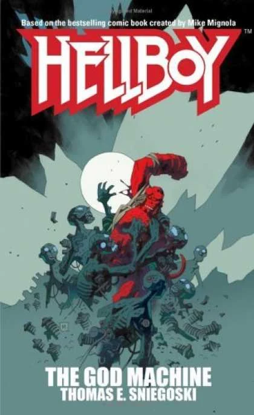<em>by</em> Mike Mignola
</td>
</tr>
<tr class="even">
<td>
<em><a href="Hellboy:_The_Dragon_Pool" title="wikilink">Hellboy: The Dragon Pool</a></em>
</td>
<td>
March, 2007
</td>
<td>
Christopher Golden
</td>
<td>
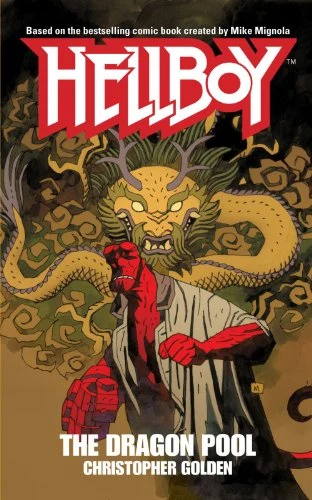<em>by</em> Mike Mignola
</td>
</tr>
<tr class="odd">
<td>
<em><a href="Hellboy:_Emerald_Hell" title="wikilink">Hellboy: Emerald Hell</a></em>
</td>
<td>
February 13, 2008
</td>
<td>
Tom Piccirilli
</td>
<td>
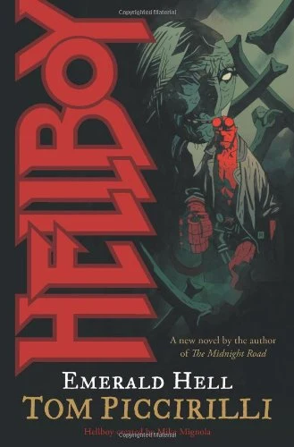<em>by</em> Mike Mignola
</td>
</tr>
<tr class="even">
<td>
<em><a href="Hellboy:_The_All-Seeing_Eye" title="wikilink">Hellboy: The All-Seeing Eye</a></em>
</td>
<td>
October 22, 2008
</td>
<td>
Mark Morris
</td>
<td>
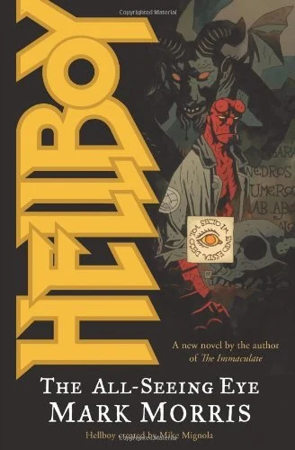<em>by</em> Mike Mignola
</td>
</tr>
<tr class="odd">
<td>
<em><a href="Hellboy:_The_Fire_Wolves" title="wikilink">Hellboy: The Fire Wolves</a></em>
</td>
<td>
April 1, 2009
</td>
<td>
Tim Lebbon
</td>
<td>
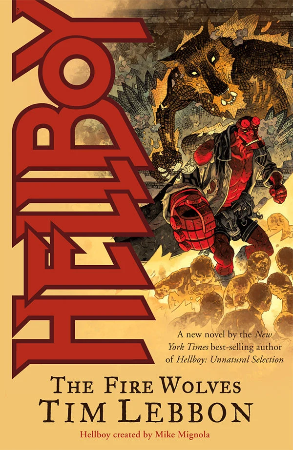<em>by</em> Duncan Fegredo
</td>
</tr>
<tr class="even">
<td>
<em><a href="Lobster_Johnson:_The_Satan_Factory" title="wikilink">Lobster Johnson: The Satan Factory</a></em>
</td>
<td>
July 22, 2009
</td>
<td>
Thomas E. Sniegoski
</td>
<td>
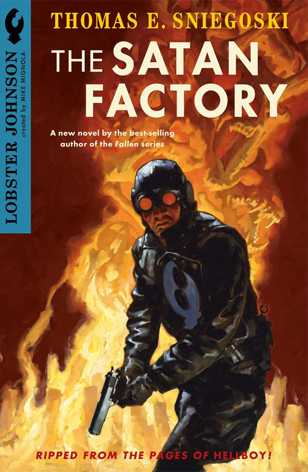<em>by</em> Gregory Manchess
</td>
</tr>
<tr class="odd">
<td>
<em><a href="Hellboy:_The_Ice_Wolves" title="wikilink">Hellboy: The Ice Wolves</a></em>
</td>
<td>
September 30, 2009
</td>
<td>
Mark Chadbourn
</td>
<td>
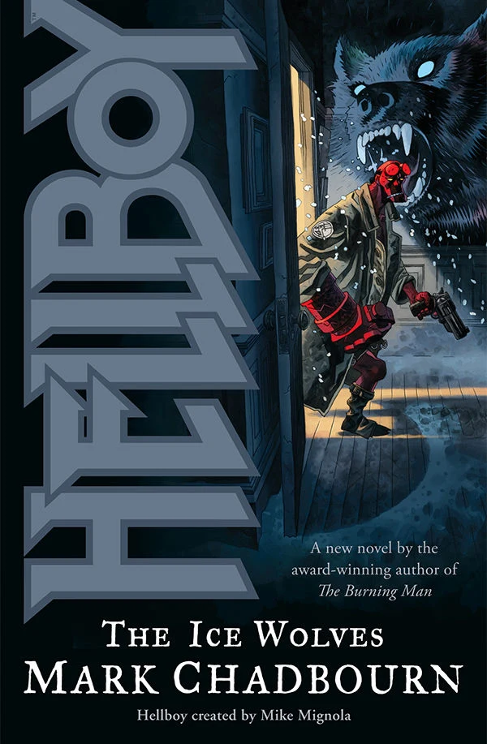<em>by</em> Duncan Fegredo
</td>
</tr>
</tbody>
</table>

### Prose Anthology Collections

The antholgy collections were all edited by Christopher Golden.

<table>
<thead>
<tr class="header">
<th>
Title
</th>
<th>
Cover
</th>
<th>
Date Published
</th>
<th>
Story
</th>
<th>
Author/s
</th>
</tr>
</thead>
<tbody>
<tr class="odd">
<td rowspan="14">
<em><a href="Hellboy:_Odd_Jobs" title="wikilink">Hellboy: 
Odd Jobs</a></em>
</td>
<td rowspan="14">
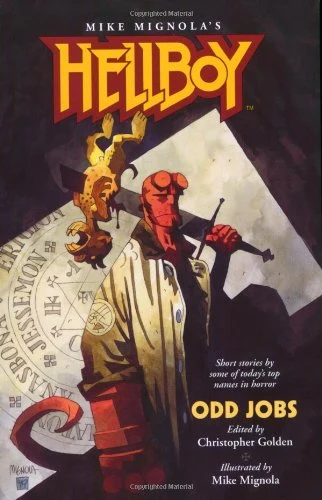<em>by</em> Mike Mignola
</td>
<td rowspan="14">
December 15, 1999
</td>
<td>
<em>Medusa's Revenge</em>
</td>
<td>
Yvonne Navarro
</td>
</tr>
<tr class="even">
<td>
<em>Jigsaw</em>
</td>
<td>
Stephen Bissette
</td>
</tr>
<tr class="odd">
<td>
<em>A Mother Cries at Midnight</em>
</td>
<td>
Philip Nutman
</td>
</tr>
<tr class="even">
<td>
<em>Delivered</em>
</td>
<td>
Greg Rucka
</td>
</tr>
<tr class="odd">
<td>
<em>Folie á Deux</em>
</td>
<td>
Nancy Holder
</td>
</tr>
<tr class="even">
<td>
<em>Demon Politics</em>
</td>
<td>
Craig Shaw Gardner
</td>
</tr>
<tr class="odd">
<td>
<em>A Grim Fairy Tale</em>
</td>
<td>
Nancy A. Collins
</td>
</tr>
<tr class="even">
<td>
<em>Scared Crows</em>
</td>
<td>
Rick Hautala 
<em>and</em> Jim Connolly
</td>
</tr>
<tr class="odd">
<td>
<em>Where Their Fire Is Not Quenched</em>
</td>
<td>
Chet Williamson
</td>
</tr>
<tr class="even">
<td>
<em>I Had Bigfoot's Baby!</em>
</td>
<td>
Max Allan Collins
</td>
</tr>
<tr class="odd">
<td>
<em>The Nuckelavee</em>
</td>
<td>
Christopher Golden 
<em>and</em> Mike Mignola
</td>
</tr>
<tr class="even">
<td>
<em>A Night at the Beach</em>
</td>
<td>
Matthew J. Costello
</td>
</tr>
<tr class="odd">
<td>
<em>Burn, Baby, Burn</em>
</td>
<td>
Poppy Z. Brite
</td>
</tr>
<tr class="even">
<td>
<em>Far Flew the Boast of Him</em>
</td>
<td>
Brian Hodge
</td>
</tr>
<tr class="odd">
<td rowspan="16">
<em><a href="Hellboy:_Odder_Jobs" title="wikilink">Hellboy: 
Odder Jobs</a></em>
</td>
<td rowspan="16">
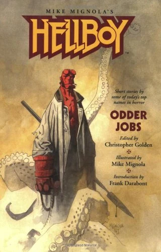<em>by</em> Mike Mignola
</td>
<td rowspan="16">
October 6, 2004
</td>
<td>
<em>The Brotherhood of the Gun</em>
</td>
<td>
Frank Darabont
</td>
</tr>
<tr class="even">
<td>
<em>From an Enchanter Fleeing</em>
</td>
<td>
Peter Crowther
</td>
</tr>
<tr class="odd">
<td>
<em>Down in the Flood</em>
</td>
<td>
Scott Allie
</td>
</tr>
<tr class="even">
<td>
<em>Newford Spook Squad</em>
</td>
<td>
Charles de Lint
</td>
</tr>
<tr class="odd">
<td>
<em>Water Music</em>
</td>
<td>
David J. Schow
</td>
</tr>
<tr class="even">
<td>
<em>The Vampire Brief</em>
</td>
<td>
James L. Cambias
</td>
</tr>
<tr class="odd">
<td>
<em>Unfinished Business</em>
</td>
<td>
Ed Gorman 
<em>&amp;</em> Richard Dean Starr
</td>
</tr>
<tr class="even">
<td>
<em>Saint Hellboy</em>
</td>
<td>
Tom Piccirilli
</td>
</tr>
<tr class="odd">
<td>
<em>Sleepless in Manhattan</em>
</td>
<td>
Nancy Kilpatrick
</td>
</tr>
<tr class="even">
<td>
<em>The Wish Hounds</em>
</td>
<td>
Sharyn McCrumb
</td>
</tr>
<tr class="odd">
<td>
<em>Act of Mercy</em>
</td>
<td>
Thomas E. Sniegoski
</td>
</tr>
<tr class="even">
<td>
<em>The Thrice-Named Hill</em>
</td>
<td>
Graham Joyce
</td>
</tr>
<tr class="odd">
<td>
<em>Of Blood, of Clay</em>
</td>
<td>
James A. Moore
</td>
</tr>
<tr class="even">
<td>
<em>A Full and Satisfying Life</em>
</td>
<td>
Ray Garton
</td>
</tr>
<tr class="odd">
<td>
<em>The Glass Road</em>
</td>
<td>
Tim Lebbon
</td>
</tr>
<tr class="even">
<td>
<em>Tasty Teeth</em>
</td>
<td>
Guillermo del Toro 
<em>&amp;</em> Matthew Robbins
</td>
</tr>
<tr class="odd">
<td rowspan="14">
<em><a href="Hellboy:_Oddest_Jobs" title="wikilink">Hellboy: 
Oddest Jobs</a></em>
</td>
<td rowspan="14">
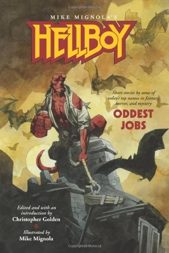<em>by</em> Mike Mignola
</td>
<td rowspan="14">
July 9, 2008
</td>
<td>
<em>Jiving with Shadows and Dragons and Long, Black Trains</em>
</td>
<td>
Joe R. Lansdale
</td>
</tr>
<tr class="even">
<td>
<em>Straight, No Chaser</em>
</td>
<td>
Mark Chadbourn
</td>
</tr>
<tr class="odd">
<td>
<em>Second Honeymoon</em>
</td>
<td>
John Skipp 
<em>&amp;</em> Cody Goodfellow
</td>
</tr>
<tr class="even">
<td>
<em>Danny Boy</em>
</td>
<td>
Ken Bruen
</td>
</tr>
<tr class="odd">
<td>
<em>Strange Fishing in the Western Highlands</em>
</td>
<td>
Garth Nix
</td>
</tr>
<tr class="even">
<td>
<em>Salamander Blues</em>
</td>
<td>
Brian Keene
</td>
</tr>
<tr class="odd">
<td>
<em>The Thursday Men</em>
</td>
<td>
Tad Williams
</td>
</tr>
<tr class="even">
<td>
<em>Produce</em>
</td>
<td>
Amber Benson
</td>
</tr>
<tr class="odd">
<td>
<em>Repossession</em>
</td>
<td>
Barbara Hambly
</td>
</tr>
<tr class="even">
<td>
<em>In Cupboards and Bookshelves</em>
</td>
<td>
Gary A. Braunbeck
</td>
</tr>
<tr class="odd">
<td>
<em>Feet of Sciron</em>
</td>
<td>
Rhys Hughes
</td>
</tr>
<tr class="even">
<td>
<em>Monster Boy</em>
</td>
<td>
Stephen Volk
</td>
</tr>
<tr class="odd">
<td>
<em>Evolution and Hellhole Canyon</em>
</td>
<td>
Don Winslow
</td>
</tr>
<tr class="even">
<td>
<em>A Room of One's Own</em>
</td>
<td>
China Miéville
</td>
</tr>
<tr class="odd">
<td rowspan="16">
<em><a href="Hellboy:_An_Assortment_of_Horrors" title="wikilink">Hellboy: 
An Assortment of Horrors</a></em>
</td>
<td rowspan="16">
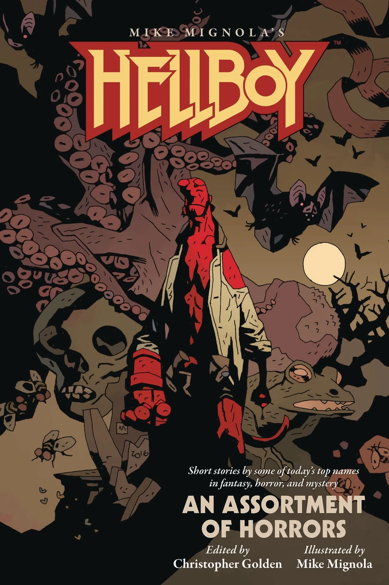<em>by</em> Mike Mignola
</td>
<td rowspan="16">
August 16, 2017
</td>
<td>
<em>The Promised Smile</em>
</td>
<td>
Rio Youers
</td>
</tr>
<tr class="even">
<td>
<em>When Doves Cry</em>
</td>
<td>
Delilah S. Dawson
</td>
</tr>
<tr class="odd">
<td>
<em>The Other Side of Summer</em>
</td>
<td>
Chris Roberson
</td>
</tr>
<tr class="even">
<td>
<em>The Hellboyness of Hellboy</em>
</td>
<td>
Chris Priestley
</td>
</tr>
<tr class="odd">
<td>
<em>One More Radical Stone Fox</em>
</td>
<td>
Chelsea Cain
</td>
</tr>
<tr class="even">
<td>
<em>The Duelist</em>
</td>
<td>
Jonathan Maberry
</td>
</tr>
<tr class="odd">
<td>
<em>A Quiet Night in the Library</em>
</td>
<td>
E. Lily Yu
</td>
</tr>
<tr class="even">
<td>
<em>Fire Is the Devil’s Only Friend</em>
</td>
<td>
Michael Rowe
</td>
</tr>
<tr class="odd">
<td>
<em>A Huge Damn Vampire</em>
</td>
<td>
Richard Kadrey
</td>
</tr>
<tr class="even">
<td>
<em>The Other Government Guys</em>
</td>
<td>
Weston Ochse
</td>
</tr>
<tr class="odd">
<td>
<em>Her Red Right Hand</em>
</td>
<td>
Paul Tremblay
</td>
</tr>
<tr class="even">
<td>
<em>To Bell the Cat</em>
</td>
<td>
Angela Slatter
</td>
</tr>
<tr class="odd">
<td>
<em>Versteckdt</em>
</td>
<td>
Kealan Patrick Burke
</td>
</tr>
<tr class="even">
<td>
<em>Of Boys and Two-headed Dogs</em>
</td>
<td>
Laird Barron
</td>
</tr>
<tr class="odd">
<td>
<em>Burning Girls</em>
</td>
<td>
Seanan Mcguire
</td>
</tr>
<tr class="even">
<td>
<em>Tales of the Worm Lord</em>
</td>
<td>
Nathan Ballingrud
</td>
</tr>
</tbody>
</table>

## Canon

Author [Christopher Golden](/entry/Christopher%20Golden) has written several *Hellboy* [novels](http://en.wikipedia.org/wiki/Novel). The first two, *The Lost Army* and *The Bones of Giants*, were both featured in the comic's official timeline featured in *Hellboy: The Companion*, as was the short story *The Nuckelavee*. Additionally, the Golden-penned character [Anastasia Bransfield](/entry/Anastasia%20Bransfield) was also described in *The Companion*, despite having never actually appearing in a comic (though she was referenced indirectly in *[Abe Sapien: The Drowning](/entry/The%20Drowning)*).

In a 2017 interview, [Mike Mignola](/entry/Mike%20Mignola), Christopher Golden, and [Chris Roberson](/entry/Chris%20Roberson) discussed which of the prose stories were canon.[1] Roberson said that Ginny (from *The Other Side of Summer*) would appear in the comics in a flashback, and Golden hinted that we may see Anastasia in a future comic, though there is currently nothing in the works.

Officially, the canon prose stories are:

- *Hellboy: The Lost Army*
- *The Nuckelavee* (from *Hellboy: Odd Jobs*)
- *Hellboy: The Bones of Giants*
- *Hellboy: The Dragon Pool*
- *The Promised Smile* (from *Hellboy: An Assortment of Horrors*)
- *The Other Side of Summer* (from *Hellboy: An Assortment of Horrors*)

## References

<references />

**Category:Prose**

[1] <http://www.multiversitycomics.com/interviews/mignolaverse2017-part1/>