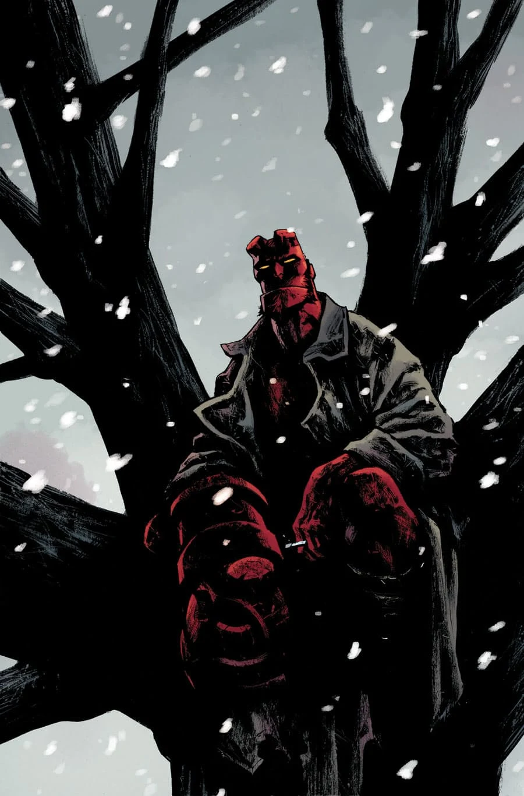

A comic special containing three stories. This comic is the Hellboy Universe debut of Tim Sale, Michael Walsh, Chris Roberson, and Chelsea Cain.

## Solicitation

Three weird tales show the world of Hellboy through the years, with Edward Grey appearing alongside Sarah Jewell, hero of the recent *Rise of the Black Flame* series in 1890s London. In 1980s New England, Hellboy, Abe Sapien, and Liz Sherman set out on a simple search for some missing kids and encounter a tormented spirit seeking to share its pain.

And Paul Grist (*Kane*, *Jack Staff*) joins the team for a 1950s *Hellboy* story providing a glimpse of the next new title to debut in the Mignolaverse.

## Featuring

- *[The Great Blizzard](/entry/The%20Great%20Blizzard)* written by Mike Mignola and Chris Roberson with art by Christopher Mitten
- *[God Rest Ye Merry](/entry/God%20Rest%20Ye%20Merry)* written by Mike Mignola and Chris Roberson with art by Paul Grist
- *[The Last Witch of Fairfield](/entry/The%20Last%20Witch%20of%20Fairfield)* written by Mike Mignola and Scott Allie with art by Sebastián Fiumara

## Gallery

文件:Hellboy Winter Special (2017).jpg|Hellboy Winter Special 2017 文件:Hellboy Winter Special (2017) Geof Darrow front.jpg|Geof Darrow variant (front) 文件:Hellboy Winter Special (2017) Geof Darrow back.jpg|Geof Darrow variant (back)

**Category:Comics**