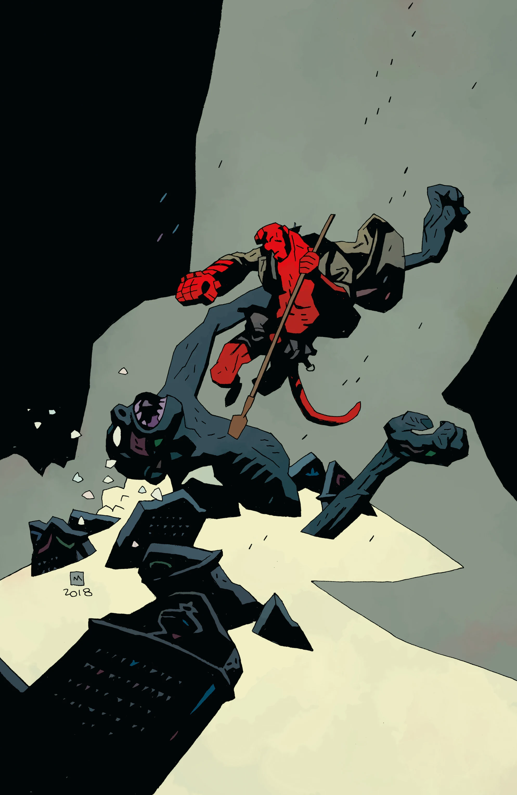

**Hellboy Winter Special (2018)** is an upcoming December 2018 anthology special featuring three stories.

## Publication History

Editor Katii O'Brien announced the comic during Dark Horse's NCBD Rundown for June 6, 2018.[1] Full solicitations were revealed for San Diego Comic-Con 2018 as a part of the 25th Anniversary of *Hellboy* announcements.

## Solicitation

Three wintery tales featuring a Mike Mignola and Ben Stenbeck team-up about a New Year’s Eve séance gone wrong when Hellboy visits a family’s English home, Fábio Moon and Gabriel Bá revisit B.P.R.D.: Vampire with a new tie-in story, and Tonci Zonjic returns to write and draw Lobster Johnson.

## Featuring

- A *[Hellboy (series)](/entry/Hellboy%20%28series%29)* story written by [Mike Mignola](/entry/Mike%20Mignola) with art by [Ben Stenbeck](/entry/Ben%20Stenbeck)
- A *[B.P.R.D.: Vampire](/entry/Vampire%20%28story%20cycle%29)* story written and drawn by [Fábio Moon](/entry/F%C3%A1bio%20Moon) and [Gabriel Bá](/entry/Gabriel%20B%C3%A1)
- A *[Lobster Johnson](/entry/Lobster%20Johnson%20%28series%29)* story written and drawn by [Tonci Zonjic](/entry/Tonci%20Zonjic)

## Gallery

文件:Hellboy Winter Special (2018).jpg|by [Mike Mignola](/entry/Mike%20Mignola) 文件:Hellboy Winter Special (2018) Ba.jpg|variant by [Gabriel Bá](/entry/Gabriel%20B%C3%A1) 文件:Hellboy Winter Special (2018) Moon.jpg|variant by [Fábio Moon](/entry/F%C3%A1bio%20Moon)

## References

<references />

**Category:Comics**

[1] [Katii O'Brien discusses the Hellboy Universe on Dark Horse's NCBD Rundown, June 6, 2018](https://www.youtube.com/watch?v=0VCS7AWbOi4&feature=youtu.be&t=759)