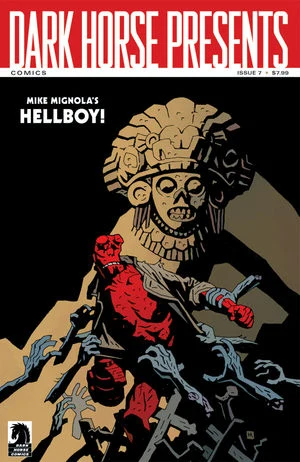

## Publication History

*Hellboy versus the Aztec Mummy* is a short story published December 2011 in *Dark Horse Presents* \#7. The story is set in 1956 during Hellboy's five-month "drunken weekend" in Mexico.

## Synopsis

The story takes place in Mexico. Although Hellboy cannot remember the events, luchadore Fernando 'The Blue Fury' Landa claims it is true.

Hellboy tracks down an Aztec mummy. The mummy turns into a bat, picks up Hellboy, and drops him in a church. Hellboy chases the bat into a graveyard where reanimated corpses attack him. After Hellboy punches the bat, it turns into a snake and a giant Aztec head appears in the sky and then disappears. Hellboy falls asleep in the graveyard with a bottle of alcohol by his side.

The story ends with Jorge Cardona, a Mexican being interviewed by the B.P.R.D., and Professor James Henry O'Donnell, a B.P.R.D. consultant, talking about how much of the story is likely to be true.

**Category:Story** **Category:Hellboy story**