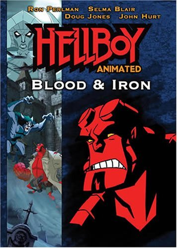

 ***Hellboy: Blood and Iron*** is the second in the *[Hellboy](/entry/Hellboy%20%28series%29)* [animated series](/entry/Hellboy%20Animated) (the first being *[Hellboy: Sword of Storms](/entry/Hellboy%3A%20Sword%20of%20Storms)*), written by Tad Stones and [Mike Mignola](/entry/Mike%20Mignola). The movie features [Hellboy](/entry/Hellboy), [Liz Sherman](/entry/Liz%20Sherman), [Abe Sapien](/entry/Abe%20Sapien), and introducing [Sidney Leach](/entry/Sidney%20Leach) (here called Sydney Leach). The film's storyline is based in part upon the Hellboy: [Wake the Devil](/entry/Wake%20the%20Devil) storyline from the original comics.

It first aired on March 17, 2007 on Cartoon Network, and aired again on July 19, 2008 to promote the release of *[Hellboy II: The Golden Army](/entry/Hellboy%20II%3A%20The%20Golden%20Army)*, and was scheduled on DVD by Anchor Bay Entertainment in March 10, 2007.

## Plot

In 1939, young [Professor Bruttenholm](/entry/Trevor%20Bruttenholm) (aka Professor Broom) fights against Erzsebet Ondrushko, a vampiress who bathed in the blood of innocents to stay young after selling her soul to the Queen of Witches, the goddess [Hecate](/entry/Hecate). During his encounters, he was too late to save a girl's from Erzsebet and the priest who accompanied him was corrupted as Erzsebet questioned his belief in God. Eventually, she was exposed to the sun, but her ashes returned to her mansion, right to a statue of Hecate. Broom leaves for Germany, for his eventual encounter of Hellboy.

Years later, a haunted mansion in the Hamptons, on Long Island, bought by a friend of an important Senator who provides the B.P.R.D. with funds, is brought to the B.P.R.D.'s attention. The elderly Professor Bruttenholm decides to investigate it himself, taking top BPRD agents, [Hellboy](/entry/Hellboy), [Liz Sherman](/entry/Liz%20Sherman), [Abe Sapien](/entry/Abe%20Sapien) and a new B.P.R.D. member named [Sidney Leach](/entry/Sidney%20Leach) who is a human metal detector who has never seen any action in the field.

Much to Bruttenholm's horror, it turns out that the ghosts are the victims of Erzsebet Ondrushko, who is soon going to be resurrected by her two harpy/hag servants. While the others deal with her hag minions, phantom wolf packs, and a werewolf transformed from one of Bruttenholm's old friends, Bruttenholm settles his affairs with Erzsebet once and for all. He mixes her bath with holy water and stabs her with a stake destroying her permanently. Hellboy ends up battling Hecate herself, who has been watching him for some time and desires him to embrace his true destiny: one that includes the destruction of mankind. However, Hellboy has no interest in his destiny and prefers protecting Earth. A fight then ensures, resulting in each blow to Hecate causing her to grow in size before Hellboy discovers her weakness: sunlight and she reverts back into a statue.

## Cast

#### Actor Role

Ron Perlman- [Hellboy](/entry/Hellboy)

Selma Blair- [Liz Sherman](/entry/Liz%20Sherman)

Doug Jones- [Abe Sapien](/entry/Abe%20Sapien)

Peri Gilpin- Professor [Kate Corrigan](/entry/Kate%20Corrigan)

John Hurt- Professor [Trevor Bruttenholm](/entry/Trevor%20Bruttenholm)

Jim Cummings- Tom Manning

Rob Paulsen- [Sydney Leach](/entry/Sidney%20Leach)

J. Grant Albrecht- Oliver Trumbolt

Cree Summer- [Hecate](/entry/Hecate)

James Arnold Taylor- Young Trevor, Father Lupescu

Grey DeLisle- Anna

Kath Soucie -[Erzsebet Ondrushko](/entry/Erzsebet%20Ondrushko)

Dee Dee Rescher -Harpy-Hags

## DVD Features

The DVD contains a number of special features including;

- The short film Iron Shoes, which is based on the [Hellboy story](/entry/The%20Iron%20Shoes) of the same name. The Iron Shoes demon is voiced by Dan Castellaneta.
- A digital version of the comic "[The Penanggalan](/entry/The%20Penanggalan)"

## Trivia

- The title is a reference to Otto von Bismarck's famous quote of "blood and iron."
- In a flashback scene towards the end of the film, a young [Trevor Bruttenholm](/entry/Trevor%20Bruttenholm) prepares for his journey. On his desk are references to a number of Hellboy comics including;
  - The Parchment from "[The Right Hand of Doom](/entry/The%20Right%20Hand%20of%20Doom)"
  - A drawing of the [Project Ragna Rok](/entry/Project%20Ragna%20Rok) symbol
  - A picture of [Rasputin](/entry/Rasputin), Kroenen, [Ilsa Haupstein](/entry/Ilsa%20Haupstein), and [Leopold Kurtz](/entry/Leopold%20Kurtz) from *[Seed of Destruction](/entry/Seed%20of%20Destruction)*
  - A book with an image of a hand holding a flaming cup, a symbol from the room where [Roger](/entry/Roger) was found in *[Wake the Devil](/entry/Wake%20the%20Devil)* \#3, and the cover of *[Almost Colossus](/entry/Almost%20Colossus)* \#1
  - and a stature of a bat from the beginning of [Hellboy: Sword of Storms](/entry/Hellboy%3A%20Sword%20of%20Storms)

**Category:Hellboy Animated** **Category:Films**