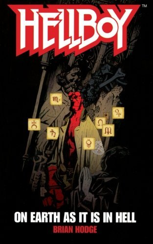

***Hellboy: On Earth as it is in Hell*** is the third *[Hellboy](/entry/Hellboy%20%28series%29)* novel, based on the comic book series by [Mike Mignola](/entry/Mike%20Mignola).

## Cover Description

Fifty years ago, a blood-red, cloven-hoofed demon was conjured up by Axis powers at the end of World War II, but adopted by the United States government, which gave him the name [Hellboy](/entry/Hellboy%20%28character%29) and raised him in secrecy. Today, Hellboy is a top field agent for the [Bureau for Paranormal Research and Defense](/entry/Bureau%20for%20Paranormal%20Research%20and%20Defense). He questions the unknown — then beats it into submission.

His latest case: Angels have attacked the Vatican, destroying an entire floor of the institution’s precious library. That’s a new one, even the Bureau for Paranormal Research and Defense. The BPRD dispatches Hellboy and his amphibious colleague, [Abe Sapien](/entry/Abe%20Sapien), to investigate. When they arrive on the scene, they discover that thousands of documents from all eras of history have been destroyed — except for one, saved from the holy fire by an obsessive scholar. His prize? An ancient scroll allegedly written by Jesus the Nazarene - decades after the crucifixion. Hellboy's first thought is that the scroll was the focus of the seraphim’s attack — but why would heavenly creatures undertake such violence and ruin?

The answer to this puzzle will lead Hellboy down a terrifying trail to ancient gods, vengeful demons, and a hidden world made of the purest evil.

## Synopsis

### Prologue

**Berlin, 1928**: WWI veteran Ernst Krieger collects a baby boy from a cabaret dancer/prostitute, assuring her that the child will be adopted by a family in the country. Instead, he delivers the baby to Matthias Herzog, leader of *Der Horn Ordern*, and is forced to take part in one of the cult's ceremonies, where the child is burned alive in the belly of an enormous statue of a man with the head of a bull.

### Part One

**Rome, Present Day**: [Hellboy](/entry/Hellboy%20%28character%29) and [Abe Sapien](/entry/Abe%20Sapien) examine the devastation inside a section of the Vatican archives, which look as though they have been firebombed, obliterating thousands of historical documents and killing dozens of people. As far as the few survivors can remember, the fire appeared spontaneously, without any intruders being spotted. Hellboy notices a distinctive odor in the air - brimstone - and realizes the fire was mystical in origin. Abe asks what can do this, and Hellboy says, [Liz](/entry/Elizabeth%20Sherman) can, but she's not there, so the next best guess is *seraphim*. Abe cannot believe that angels from Heaven would attack the home of the Catholic Church, of all places, but Hellboy says that, as far as they are described in scripture, *seraphim* are "Heaven's stormtroopers" - they go where they are pointed, and destruction, any destruction, is the essence of their nature.

**On Earth as it is in Hell**