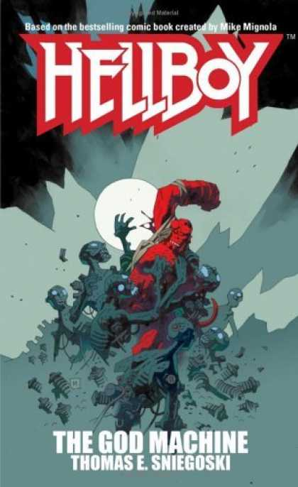

***Hellboy: The God Machine*** is the fifth *[Hellboy](/entry/Hellboy%20%28series%29)* novel, based on the comic book series by [Mike Mignola](/entry/Mike%20Mignola).

## Cover Description

Religious artifacts from every faith are disappearing without a trace. The identity of the perpetrator is a complete mystery until [Hellboy](/entry/Hellboy%20%28character%29) and [Liz Sherman](/entry/Liz%20Sherman) - acting on an unlikely tip from a ghost - foil a museum heist attempted by crude, robotic constructs inhabited by human spirits.

One of these freed human spirits offers to help Hellboy track down those who imprisoned him: a fanatical order of psychics obsessed with creating a new messiah, one that will bring about a new stage of evolution for mankind - whether mankind is willing or not. Now only Hellboy and his colleagues stand between a vulnerable humanity and an evil, vengeful god...

## Story Chronology

**God Machine**