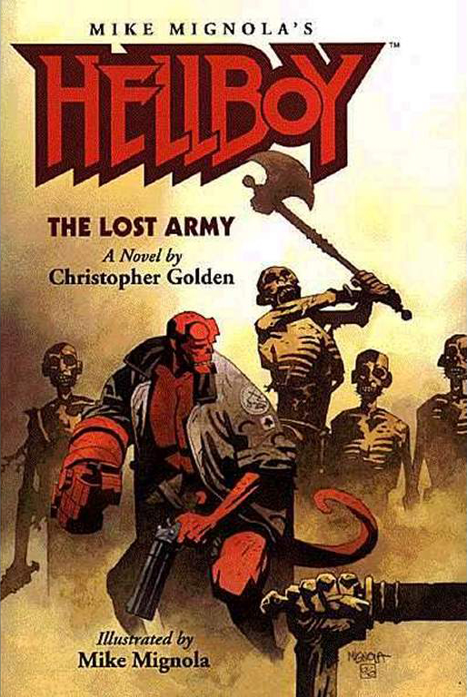

***Hellboy: The Lost Army*** is the first *[Hellboy](/entry/Hellboy%20%28series%29)* novel, based on the comic book series by [Mike Mignola](/entry/Mike%20Mignola).

## Cover Description

In 525 B.C., the Persian king Cambyses sent fifty thousand soldiers across the conquered Egyptian desert to take an oasis city not far from where the Libyan border stands today. According to Greek history, a hurricane-force sandstorm struck near the end of their six-hundred-mile trek. The army - all fifty thousand men - vanished without a single trace.

Fast forward to 1986. A British archaeological team, sent to the edge of the Great Sand Sea to exhume evidence of the incident, has also gone missing. So the Bureau for Paranormal Research and Defense is sending the world's greatest paranormal investigator, Hellboy, to find the missing Brits and to discover what became of The Lost Army.

## Story Chronology

The story takes place in 1986, eight years before *[Seed of Destruction](/entry/Seed%20of%20Destruction)*.[1]

## References

<references />

## See also

- [Hellboy Universe novels](/entry/Hellboy%20Universe%20novels)

**Lost Army**

[1] According to *[Darkness Calls](/entry/Darkness%20Calls)* \#1, [Trevor Bruttenholm](/entry/Trevor%20Bruttenholm), who is killed in the opening pages of *Seed of Destruction* died in 1994.