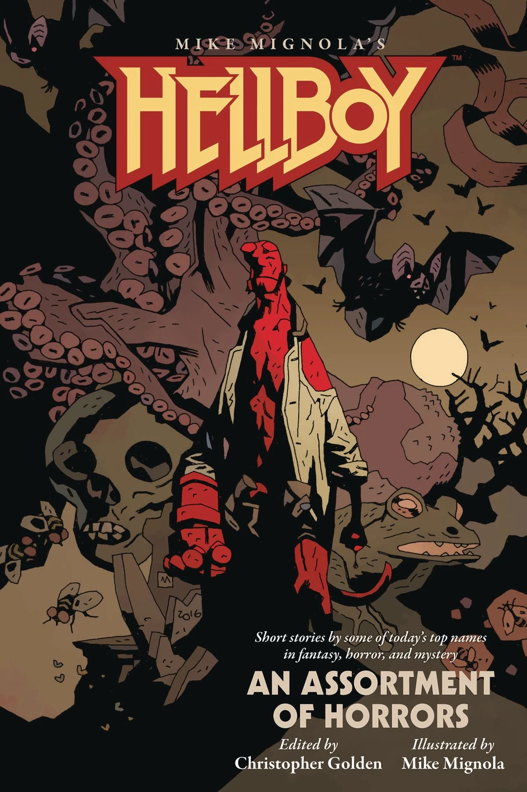

***Hellboy: An Assortment of Horrors*** is the fourth anthology collecting non-chronological short stories written for the [*Hellboy* novel series](/entry/Hellboy%20Universe%20novels), based on the comic book series by [Mike Mignola](/entry/Mike%20Mignola), who provided cover illustrations for each story.

## Contents

### *The Promised Smile*

Written by Rio Youers

This is one of two stories in this collection that is canon.[1]

### *When Doves Cry*

Written by Delilah S. Dawson

### *The Other Side of Summer*

Written by [Chris Roberson](/entry/Chris%20Roberson)

This is one of two stories in this collection that is canon.[2]

### *The Hellboyness of Hellboy*

Written and Illustrated by Chris Priestley

### *One More Radical Stone Fox*

Written by Chelsea Cain

### *The Duelist*

Written by Jonathan Maberry

### *A Quiet Night in the Library*

Written by E. Lily Yu

### *Fire Is the Devil’s Only Friend*

Written by Michael Rowe

### *A Huge Damn Vampire*

Written by Richard Kadrey

### *The Other Government Guys*

Written by Weston Ochse

### *Her Red Right Hand*

Written by Paul Tremblay

### *To Bell the Cat*

Written by Angela Slatter

### *Versteckdt*

Written by Kealan Patrick Burke

### *Of Boys and Two-headed Dogs*

Written by Laird Barron

### *Burning Girls*

Written by Seanan Mcguire

### *Tales of the Worm Lord*

Written by Nathan Ballingrud

## References

<references />

**Category:Prose**

[1] <http://www.multiversitycomics.com/interviews/mignolaverse2017-part1>

[2]