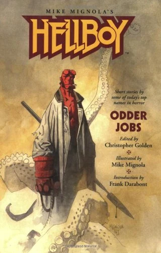

***Hellboy: Odder Jobs*** is the second anthology collecting non-chronological short stories written for the [*Hellboy* novel series](/entry/Hellboy%20Universe%20novels), based on the comic book series by [Mike Mignola](/entry/Mike%20Mignola), who provided cover illustrations for each story.

## Contents

### *The Brotherhood of the Gun*

Written by Frank Darabont

Hellboy has to confront a re-enactor in a Wild West tourist town, who is unaware that he is the ghost of a genuine gunfighter who has been dead for a century.

### *From an Enchanter Fleeing*

Written by Peter Crowther

Hellboy investigates a mysterious fog in a small New England town from which ghosts are emerging.

### *Down in the Flood*

Written by Scott Allie

[Abe Sapien](/entry/Abe%20Sapien) has to determine what kind of force is snatching the inhabitants of a flooded Ohio town.

### *The Newford Spook Squad*

Written by Charles de Lint

A skeptical police detective appointed as the head of Newford's new Paranormal Investigations Task Force becomes a believer when his squad is partnered with Hellboy and [Liz Sherman](/entry/Liz%20Sherman) for their first case.

### *Water Music*

Written by David J. Schowr

While sleeping underwater, [Abe Sapien](/entry/Abe%20Sapien) becomes susceptible to vague memories of his origins.

### *The Vampire Brief*

Written by James L. Cambias

A flamboyant vampire is living in plain sight in New Orleans; since all of his "victims" are willing volunteers, Hellboy has to try an unusual tactic to lure the vampire into sunlight: filing a lawsuit.

### *Unfinished Business*

Written by Ed Gorman & Richard Dean Starr

During the Korean War, Hellboy is called in by an old acquaintance to stop a succubus preying on the young men of an Army base.

### *Saint Hellboy*

Written by Tom Piccirilli

Hellboy is asked by a priest to help free his mother (the wife of a prominent Mafia Don) from suspected demonic possession.

### *Sleepless in Manhatta*n

Written by Nancy Kilpatrick

A demon is stalking the people of Manhattan at night.

### *The Wish Hounds*

Written by Sharyn McCrumb

Hellhounds are preying on the children of a small town in Appalachia, and Hellboy suspects the inhabitants of an upscale gated community nearby.

### *Act of Mercy*

Written by Thomas E. Sniegoski

A decrepit demon, long past its prime, kidnaps children and issues a challenge to Hellboy, wanting nothing more than to go out with a bang.

### *The Thrice-Named Hill*

Written by Graham Joyce

An archaeological team disappears while excavating an ancient mound in Great Britain. When Hellboy confronts the monster responsible, he is stunned when she introduces herself as his sister.

### *Of Blood, of Clay*

Written by James A. Moore

[Roger](/entry/Roger) must try to reason with a golem created during World War II that is rampaging in modern Germany, either unaware or simply not caring that the Nazis were defeated decades ago.

### *A Full and Satisfying Life*

Written by Ray Garton

Bullying at an exclusive boarding school leads to tragedy when a Greek exchange student has had enough and summons a manticore to punish his tormentors.

### *The Glass Road*

Written by Tim Lebbon

Fire demons have scorched a stretch of the Arabian desert into pure glass, and Hellboy fears that the road will lead straight to Hell if he and Liz follow it to its end.

### *Tasty Teeth*

Written by [Guillermo del Toro](/entry/Guillermo%20del%20Toro) & Matthew Robbins

Investigating several missing children in Romania, Hellboy encounters the true-life version of tooth fairies.

**Odder Jobs**