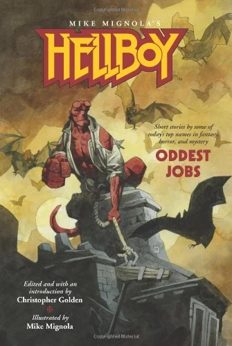

***Hellboy: Oddest Jobs*** is the third anthology collecting non-chronological short stories written for the [*Hellboy* novel series](/entry/Hellboy%20Universe%20novels), based on the comic book series by [Mike Mignola](/entry/Mike%20Mignola), who provided cover illustrations for each story.

## Contents

### *Jiving with Shadows and Dragons and Long, Black Trains*

Written by Joe R. Lansdale

### *Straight, No Chaser*

Written by Mark Chadbourn

### *Second Honeymoon*

Written by John Skipp & Cody Goodfellow

### *Danny Boy*

Written by Ken Bruen

### *Strange Fishing in the Western Highlands*

Written by Garth Nix

### *Salamander Blues*

Written by Brian Keene

### *The Thursday Men*

Written by Tad Williams

### *Produce*

Written by Amber Benson

### *Repossession*

Written by Barbara Hambly

### *In Cupboards and Bookshelves*

Written by Gary A. Braunbeck

### *Feet of Sciron*

Written by Rhys Hughes

### *Monster Boy*

Written by Stephen Volk

### *Evolution and Hellhole Canyon*

Written by Don Winslow

### *A Room of One's Own*

Written by China Miéville

**Category:Prose**