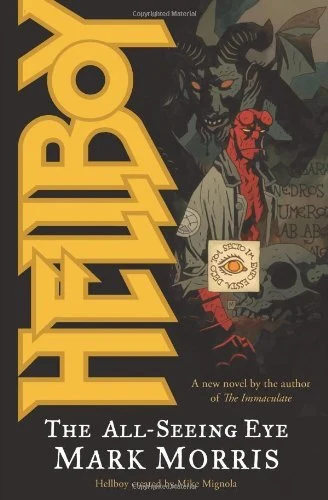

***Hellboy: The All-Seeing Eye*** is the eighth *[Hellboy](/entry/Hellboy%20%28series%29)* novel, based on the comic book series by [Mike Mignola](/entry/Mike%20Mignola).

## Cover Description

In a London funeral parlor, the dead rise and walk again. On a train in the London Underground, a young couple is terrorized by a demon. In a suburb, a poltergeist forces a family to flee their home.

[Hellboy](/entry/Hellboy%20%28character%29) has his hands full.

While the supernatural is on a rampage in London, a series of brutal "Torso Murders" turns up at various sites around the city. All of the corpses are headless, limbless, and drained of their blood.

Called in to investigate the killings, B.P.R.D. agents [Abe Sapien](/entry/Abe%20Sapien) and [Liz Sherman](/entry/Liz%20Sherman) discover a wellspring of black magic under the London streets. They also find a sack of heads. Hellboy descends into the dark underworld of London, encountering demons who prophesy the coming of plague and the opening of an Eye to the otherworld, bringing forth death and destruction upon the land.

## Story Chronology

**All-Seeing Eye**