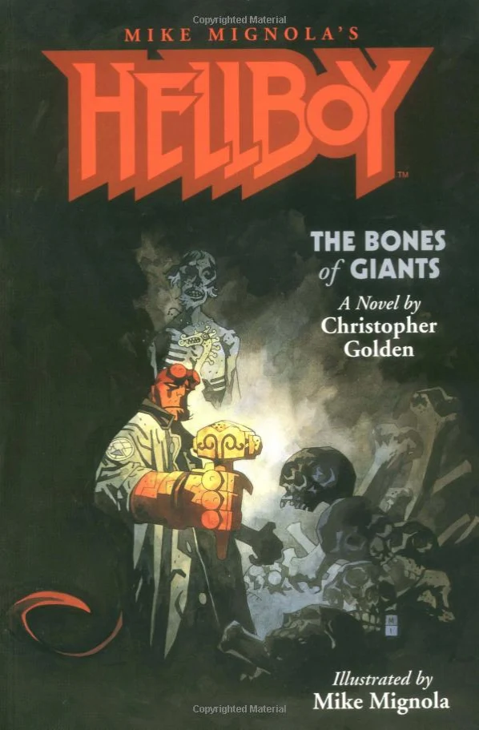

***Hellboy: The Bones of Giants*** is the second *[Hellboy](/entry/Hellboy%20%28series%29)* novel, based on the comic book series by [Mike Mignola](/entry/Mike%20Mignola).

## Cover Description

On the frozen shores of Sweden, lightning strikes from a clear sky. The skeleton of a huge man is revealed, its fingers clutched around the handle of an iron hammer. No one who comes to see this marvel from Norse mythology can lift it - no one but [Hellboy](/entry/Hellboy%20%28character%29), who lifts the hammer just in time for lightning to strike again, welding it to his hand and leading him towards a bizarre series of visions and encounters.

## Story Chronology

The story takes place several decades after Hellboy's first encounter with [Edmond Aickman](/entry/Edmond%20Aickman) in *[King Vold](/entry/King%20Vold)*.

**Bones of Giants**