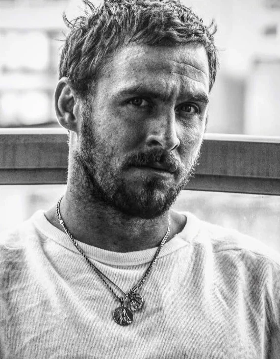

*关于 2008 年的原版漫画，见[《扭曲人》（漫画故事）](/entry/The_Crooked_Man_(comic_story))。*
*译名说明：The Crooked Man 在民间汉化组「不高兴汉化」中原译《驼背人》；2024 年真人电影上映后，简体中文网络通行译名为《扭曲人》。本站现统一采用《扭曲人》为标准名，保留旧译以备查考。*

黑暗之物，总在召唤黑暗之物。

***《地狱男爵：扭曲人》***是一部 2024 年的民俗恐怖超级英雄电影，改编自 [Mike Mignola](/entry/Mike_Mignola) 创作的 Dark Horse Comics 漫画系列 *[《地狱男爵》](/entry/Hellboy_(series))*；影片具体取材自 Mignola 编剧、[Richard Corben](/entry/Richard_Corben) 作画的[限定系列《扭曲人》](/entry/The_Crooked_Man_(comic_story))。

《扭曲人》由 [Brian Taylor](/entry/Brian_Taylor) 执导，剧本由 Mignola 与 [Christopher Golden](/entry/Christopher_Golden) 共同撰写。[Jack Kesy](/entry/Jack_Kesy) 饰演[地狱男爵](/entry/Hellboy_(character))，[Martin Bassindale](/entry/Martin_Bassindale) 饰演片名所指的[扭曲人](/entry/Jeremiah_Witkins)，[Jefferson White](/entry/Jefferson_White) 与 [Adeline Rudolph](/entry/Adeline_Rudolph) 出演配角。影片于 2023 年 3 月至 5 月在保加利亚拍摄。

本片与此前三部《地狱男爵》真人改编电影均无关联，是该系列的一次重启。

《地狱男爵：扭曲人》的制作预算远低于以往的真人作品，宣传与发行也十分有限——甚至放弃了在美国的院线上映。影评人对影片评价褒贬不一：许多人批评其技术层面或对构思的执行（也有人将其与[2004 年的电影](/entry/Hellboy_(2004_film))作 unfavorable 的比较），但也有人赞赏其恐怖氛围，或认为这个格局更小的故事颇具吸引力（不少人指出它对漫画的还原度很高）。

## 剧情

20 世纪 50 年代，[B.P.R.D.](/entry/Bureau_for_Paranormal_Research_and_Defense) 探员[地狱男爵](/entry/Hellboy)与[博比·乔·宋](/entry/Bobbie_Jo_Song)奉命乘火车将一只有毒的超自然蜘蛛押送至总部。然而，当他们穿越阿巴拉契亚山脉时，那只蜘蛛骤然膨胀成怪物般的庞然大物，导致他们所在的车厢倾覆，蜘蛛借机逃走。地狱男爵推测蜘蛛之所以变大，是因为这片区域盘踞着某种邪恶之物；他承认自己听到了它在召唤自己。被困荒野后，地狱男爵与博比·乔一路游荡，遇到了[汤姆·费雷尔](/entry/Tom_Ferrell)——一个不久前回到家乡、为往日罪孽赎罪的本地人。两位探员随汤姆前去拜访女巫、汤姆的前女友[科拉·费希尔](/entry/Cora_Fisher)，却发现房子空空如也，科拉的躯体也只剩一张皮囊。

趁众人等待恶魔仆从带着科拉的完整躯体归来之际，汤姆向探员们讲述：他曾遇到[埃菲·科尔布](/entry/Effie_Kolb_(character))，一个引他涉足巫术的[女巫](/entry/Witches)，还说服他与一个名为"[扭曲人](/entry/Jeremiah_Witkins)"的存在订下契约。在埃菲的指点下，汤姆用一具猫的尸体召唤了扭曲人——约定当那存在降临时，他手中所握的无论哪根骨头都会成为他的[幸运骨](/entry/Lucky_cat_bone)。然而，扭曲人的模样把汤姆吓得幡然醒悟、丢掉了幸运骨，可那根骨头总会自己回来，并一直护他免遭伤害。汤姆打算与扭曲人做个了断。当仆从把科拉的躯体带回时，科拉向汤姆透露：当地的女巫们想要她的灵魂。

令汤姆震惊的是，埃菲骑着一匹白马前来收取科拉的灵魂。地狱男爵出言威胁埃菲之后，那匹白马突然化作汤姆父亲的模样，埃菲则趁乱逃走。汤姆与父亲短暂和解，随后父亲便离世了。次日清晨，汤姆、科拉和两位探员前往附近一座由[沃茨牧师](/entry/Nathanial_Armstrong_Watts)主持的教堂，准备安葬汤姆的父亲，可科拉却被一条恶魔之蛇袭击身亡。地狱男爵成功杀死了蛇，但蛇的咬噬让他看见了自己母亲[萨拉](/entry/Sarah_Hughes)的幻象——一个曾与恶魔订约的女巫。

幸存者抵达教堂，在那里遭遇了扭曲人及其仆从。汤姆一度动念，想把幸运骨还给扭曲人，被地狱男爵拦下。地狱男爵与扭曲人的手下交战时，扭曲人试图以青春与视力为饵，诱使双目失明的牧师交出汤姆。沃茨拒绝屈从于诱惑，并用汤姆的幸运骨为一把铲子祝圣；借助这把铲子，地狱男爵得以削弱扭曲人、瓦解其手下。

地狱男爵与汤姆把扭曲人追至一座[废弃宅邸](/entry/The_Hurricane)，却遭到创伤性幻象的侵袭。博比·乔认定扭曲人的力量来自镇上的矿井，便经教堂下方的入口进入一片隧道系统。她用一道咒语破坏了扭曲人的力量之源，将地狱男爵与汤姆从幻象中解救出来，并摧毁了扭曲人。

在隧道的废墟中，博比·乔找到了那只已经缩小的蜘蛛，把它重新装进一个小罐子里。她与地狱男爵找到一部紧急电话，成功联系上 B.P.R.D. 请求接应。汤姆感到心头重担终于卸下。众人又一次遇到埃菲：由于不再拥有扭曲人赐予的力量，她此刻已变得苍老不堪。科尔布曾用一道受诅咒的马笼头套在汤姆父亲身上，如今这笼头套到了她自己身上，她被变成了一匹马的模样。地狱男爵在它的毛皮上写下一句警告："当心！我是女巫！"

## 演员阵容

- [Jack Kesy](/entry/Jack_Kesy) 饰 [地狱男爵](/entry/Hellboy_(character))
- [Jefferson White](/entry/Jefferson_White) 饰 [汤姆·费雷尔](/entry/Tom_Ferrell)
- [Adeline Rudolph](/entry/Adeline_Rudolph) 饰 [博比·乔·宋](/entry/Bobbie_Jo_Song)
- [Hannah Margetson](/entry/Hannah_Margetson) 饰 [科拉·费希尔](/entry/Cora_Fisher)
- [Leah McNamara](/entry/Leah_McNamara) 饰 [埃菲·科尔布](/entry/Effie_Kolb_(character))
- [Joseph Marcell](/entry/Joseph_Marcell) 饰 [沃茨牧师](/entry/Nathanial_Armstrong_Watts)
- [Martin Bassindale](/entry/Martin_Bassindale) 饰 [昂塞尔姆先生 / 扭曲人](/entry/Jeremiah_Witkins)
- Carola Colombo 饰 [萨拉](/entry/Sarah_Hughes)
- Nathan Cooper 饰 农场雇工

[阿扎尔](/entry/Azzael)也在片中登场。

## 制作

### 立项

2023 年 2 月，Millennium Media 宣布计划推出一部名为《地狱男爵：扭曲人》的全新真人重启电影，作为一个潜在系列电影的首部。影片由 Nu Boyana Film Studios 与 Campbell Grobman Films 联合制作，由 Millennium Media 联合 Dark Horse Entertainment 共同呈献。

制作于 2023 年 4 月在保加利亚启动，由 [Brian Taylor](/entry/Brian_Taylor) 执导，剧本出自漫画创作者 [Mike Mignola](/entry/Mike_Mignola) 与其长期合作者 [Christopher Golden](/entry/Christopher_Golden) 之手，改编自 2008 年的[同名漫画限定系列](/entry/The_Crooked_Man_(comic_story))。Taylor 表示，他有意"重置"这个电影系列，塑造一个更年轻、四处漂泊的[地狱男爵](/entry/Hellboy_(character))，并像漫画那样融入民俗恐怖的气质；Taylor 还确认，与[2019 年的电影](/entry/Hellboy_(2019_film))一样，《地狱男爵：扭曲人》将定为 R 级，以呈现漫画中"黑暗、惊悚、暴力且成人向"的元素。他希望讲述"一个更接地气、更私人的故事，而不是前三部那种席卷全球的末世格局"。

### 选角

次月，[Jack Kesy](/entry/Jack_Kesy) 获选出演[地狱男爵](/entry/Hellboy_(character))本人，Jefferson White、Adeline Rudolph 与 Hannah Margaretson 则分别饰演[汤姆·费雷尔](/entry/Tom_Ferrell)、[博比·乔·宋](/entry/Bobbie_Jo_Song)与[科拉·费希尔](/entry/Cora_Fisher)。Martin Bassindale 获选饰演[扭曲人](/entry/Jeremiah_Witkins)。

### 拍摄

主体拍摄于 2023 年 3 月在保加利亚开始，并于同年 5 月 15 日杀青。

[地狱男爵](/entry/Hellboy_(character))与[扭曲人](/entry/Jeremiah_Witkins)均采用实体特效（practical effects）制作。

### 后期制作

Ketchup Entertainment 获宣布成为影片的发行方。

## 画廊

### 宣传物料

电影标识

美国/SDCC 海报

英国海报

国际版海报

国际版预告片缩略图

越南广告

#### Jack Kesy 饰演地狱男爵

### 影片截图

地狱男爵坐在 B.P.R.D. 的火车车厢里。

地狱男爵从损毁的车厢中走出。

烟不离手。

被困阿巴拉契亚

博比·乔与地狱男爵查看[巫球（witchball）](/entry/Witchball)的受害者。

费雷尔、地狱男爵与宋

地狱男爵查看科拉的小屋。

等待[科拉·费希尔](/entry/Cora_Fisher)回到她的小屋。

地狱男爵与博比·乔目睹科拉回到自己的皮囊中。

[埃菲·科尔布](/entry/Effie_Kolb)骑在一匹老弱的瘦马上。

神情恍惚的地狱男爵。

地狱男爵与博比·乔·宋在教堂里。

汤姆与科拉在教堂里。

地狱男爵检查他的左轮手枪。

扭曲人

一具复苏的尸体袭击教堂。

地狱男爵被教堂墓地里复活的尸群围困。

沃茨牧师

汤姆·费雷尔挥动由牧师祝圣过的铲子。

博比·乔、汤姆与地狱男爵

### 幕后

Jefferson White 在片场。

Brian Taylor 给 Martin Bassindale 说戏。

给 Kesy 上地狱男爵妆。

### 视频

《地狱男爵：扭曲人》官方先导预告

先导预告片

《地狱男爵：扭曲人》官方预告片（2024）Jack Kesy、Adeline Rudolph、Leah McNamara

官方预告片

《地狱男爵：扭曲人》官方"变身"片段——Comic Con（2024）Jack Kesy

"变身"片段——科拉的浣熊仆从回到她的皮囊中

《地狱男爵：扭曲人》——蛇之袭击（官方片段）

"蛇之袭击"片段

## 花絮

- 《地狱男爵：扭曲人》是[《地狱男爵》](/entry/Hellboy_(series))系列首部不设定在当代（按上映时计）的电影；故事发生在 20 世纪 50 年代。
- 地狱男爵创作者 [Mike Mignola](/entry/Mike_Mignola) 认为本片是迄今为止最忠于漫画的改编作品之一："在其他 *[地狱男爵]* 电影里，总有那么几个瞬间让我觉得'哦，酷，这就是漫画里的感觉'。但这一部，它本身就几乎是那本漫画。"
- 一张英国海报把本片宣传为《地狱男爵》系列的第四部。尽管这确实是该角色登场的第四部真人电影，但它们之间并不像这一宣传语所暗示的那样在剧情上相连；四部之中，只有 *[《地狱男爵》](/entry/Hellboy_(2004_film))* 与 *[《地狱男爵2：黄金军团》](/entry/Hellboy_II__The_Golden_Army)* 彼此处于同一连续性。
- 影片还改编了 *[《锁链棺材》](/entry/The_Chained_Coffin)* 中的部分元素。

### 与漫画《地狱男爵：扭曲人》的差异

- 影片中的原创角色[博比·乔·宋](/entry/Bobbie_Jo_Song)并未在漫画中登场。
