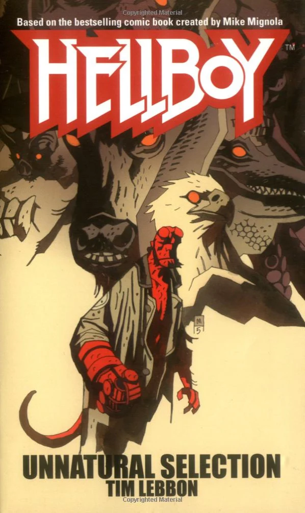

***Hellboy: Unnatural Selection*** is the fourth *[Hellboy](/entry/Hellboy%20%28series%29)* novel, based on the comic book series by [Mike Mignola](/entry/Mike%20Mignola).

## Cover Description

A dragon is seen perching on the statue of Christ the Redeemer overlooking Rio de Janeiro... A werewolf stalks the streets of Baltimore... A griffin slaughters a herd of horses in Madrid...

Weird sightings of cryptozoological and mythological creatures abound around the globe. Sometimes the creatures simply appear and then vanish again, content merely to put in an appearance. Other times they make themselves known to entire cities, and leave their mark. Damaged buildings. Scars on the landscape. The occasional death. Then suddenly, the death toll escalates. One by one [Hellboy](/entry/Hellboy%20%28character%29) and his friends at the [BPRD](/entry/BPRD) are dispatched to avert disaster. Hellboy encounters a dragon in Brazil. [Abe Sapien](/entry/Abe%20Sapien) tackles a giant alligator in Venice. [Liz Sherman](/entry/Liz%20Sherman) faces off against a phoenix in the Mediterranean. But in dawning horror they realize it's all a distraction - heralding nothing so much as an event of apocalyptic proportions...

## Story Chronology

**Unnatural Selection**