***Hellboy: Weird Tales*** is a non-canonical comic book series published during the making of the [first *Hellboy* movie](/entry/Hellboy%20%282004%20film%29). [Mike Mignola](/entry/Mike%20Mignola) had been very active during the production of the film and did not have time to work on new *Hellboy* comics. *Hellboy: Weird Tales* was a way to have new *Hellboy* material on shelves during both the lead up to and then the film's release.

The series ran for eight issues from February 2003 to April 2004, published on a bi-monthly basis. Each issue features multiple short stories from different creative teams.

## Issues

<table>
<thead>
<tr class="header">
<th>
Issue Number
</th>
<th>
Published
</th>
<th>
Cover
</th>
<th>
Story
</th>
<th>
Writer(s)
</th>
<th>
Artist(s)
</th>
<th>
Additional Materials
</th>
</tr>
</thead>
<tbody>
<tr class="odd">
<td rowspan="4">
1
</td>
<td rowspan="4">
February 26, 2003
</td>
<td rowspan="4">
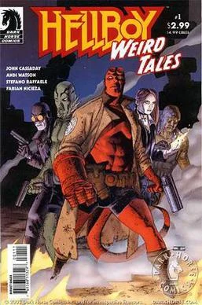<a href="John_Cassaday" title="wikilink">JOHN CASSADAY</a>
</td>
<td>
<em><a href="Big-Top-Hell-Boy" title="wikilink">Big-Top-Hell-Boy</a></em>
</td>
<td colspan="2">
<a href="John_Cassaday" title="wikilink">John Cassaday</a>
</td>
<td rowspan="4">
<em>Sugar Coated Wire feat. Dr. Karl Ruprect Kroenen</em> pin-up by <a href="TyRuben_Ellingson" title="wikilink">TyRuben Ellingson</a>
</td>
</tr>
<tr class="even">
<td>
<em><a href="Party_Pooper" title="wikilink">Party Pooper</a></em>
</td>
<td colspan="2">
<a href="Andi_Watson" title="wikilink">Andi Watson</a>
</td>
</tr>
<tr class="odd">
<td>
<em><a href="Children_of_the_Black_Mound" title="wikilink">Children of the Black Mound</a></em>
</td>
<td>
<a href="Fabian_Nicieza" title="wikilink">Fabian Nicieza</a>
</td>
<td>
<a href="Stefano_Raffaele" title="wikilink">Stefano Raffaele</a>
</td>
</tr>
<tr class="even">
<td>
<em><a href="Doc_Hollow&#39;s_Grand_Vibro-Destructo_Machine" title="wikilink">Doc Hollow's Grand Vibro-Destructo Machine: Episode 1</a></em>
</td>
<td colspan="2">
<a href="John_Cassaday" title="wikilink">John Cassaday</a>
</td>
</tr>
<tr class="odd">
<td rowspan="5">
2
</td>
<td rowspan="5">
April 23, 2003
</td>
<td rowspan="5">
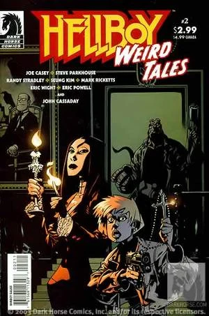<a href="Jason_Pearson" title="wikilink">JASON PEARSON</a>
</td>
<td>
<em><a href="Flight_Risk" title="wikilink">Flight Risk</a></em>
</td>
<td>
<a href="Joe_Casey" title="wikilink">Joe Casey</a>
</td>
<td>
<a href="Steve_Parkhouse" title="wikilink">Steve Parkhouse</a>
</td>
<td rowspan="5">
NA
</td>
</tr>
<tr class="even">
<td>
<em><a href="Hot" title="wikilink">Hot</a></em>
</td>
<td>
<a href="Randy_Stradley" title="wikilink">Randy Stradley</a>
</td>
<td>
<a href="Seung_Kim" title="wikilink">Seung Kim</a>
</td>
</tr>
<tr class="odd">
<td>
<em><a href="Curse_of_the_Haunted_Doily" title="wikilink">Curse of the Haunted Doily</a></em>
</td>
<td>
<a href="Mark_Ricketts" title="wikilink">Mark Ricketts</a>
</td>
<td>
<a href="Eric_Wright" title="wikilink">Eric Wright</a>
</td>
</tr>
<tr class="even">
<td>
<em><a href="Midnight_Cowboy" title="wikilink">Midnight Cowboy</a></em>
</td>
<td colspan="2">
<a href="Eric_Powell" title="wikilink">Eric Powell</a>
</td>
</tr>
<tr class="odd">
<td>
<em><a href="Doc_Hollow&#39;s_Grand_Vibro-Destructo_Machine" title="wikilink">Doc Hollow's Grand Vibro-Destructo Machine: Episode 2</a></em>
</td>
<td colspan="2">
<a href="John_Cassaday" title="wikilink">John Cassaday</a>
</td>
</tr>
<tr class="even">
<td rowspan="4">
3
</td>
<td rowspan="4">
June 25, 2003
</td>
<td rowspan="4">
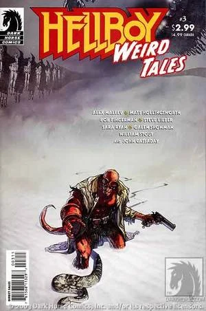<a href="Alex_Maleev" title="wikilink">ALEX MALEEV</a>
</td>
<td>
<em><a href="Still_Born" title="wikilink">Still Born</a></em>
</td>
<td>
<a href="Matt_Hollingsworth" title="wikilink">Matt Hollingsworth</a> &amp; <a href="Alex_Maleev" title="wikilink">Alex Maleev</a>
</td>
<td>
<a href="Alex_Maleev" title="wikilink">Alex Maleev</a>
</td>
<td rowspan="4">
<em>Hellboy v. Rasputin</em> pin-up by <a href="Galen_Showman" title="wikilink">Galen Showman</a> 
&amp; 
<em>Hellboy at the Mountains of Madness</em> pin-up by <a href="William_Stout" title="wikilink">William Stout</a>
</td>
</tr>
<tr class="odd">
<td>
<em><a href="Downtime" title="wikilink">Downtime</a></em>
</td>
<td colspan="2">
<a href="Bob_Fingerman" title="wikilink">Bob Fingerman</a>
</td>
</tr>
<tr class="even">
<td>
<em><a href="Family_Story" title="wikilink">Family Story</a></em>
</td>
<td>
<a href="Sara_Ryan" title="wikilink">Sara Ryan</a>
</td>
<td>
<a href="Steve_Lieber" title="wikilink">Steve Lieber</a>
</td>
</tr>
<tr class="odd">
<td>
<em><a href="Doc_Hollow&#39;s_Grand_Vibro-Destructo_Machine" title="wikilink">Doc Hollow's Grand Vibro-Destructo Machine: Episode 3</a></em>
</td>
<td colspan="2">
<a href="John_Cassaday" title="wikilink">John Cassaday</a>
</td>
</tr>
<tr class="even">
<td rowspan="4">
4
</td>
<td rowspan="4">
August 27, 2003
</td>
<td rowspan="4">
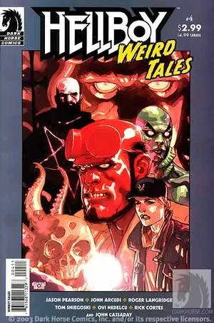<a href="Leinil_Francis_Yu" title="wikilink">Leinil Francis Yu</a>
</td>
<td>
<em><a href="The_Dread_Within" title="wikilink">The Dread Within</a></em>
</td>
<td colspan="2">
<a href="Jason_Pearson" title="wikilink">Jason Pearson</a>
</td>
<td rowspan="4">
<em>Shred</em> pin-up by <a href="Rick_Cortes" title="wikilink">Rick Cortes</a>
</td>
</tr>
<tr class="odd">
<td>
<em><a href="Abe_Sapien:_Star_of_the_B.P.R.D." title="wikilink">Abe Sapien: Star of the B.P.R.D.</a></em>
</td>
<td>
<a href="John_Arcudi" title="wikilink">John Arcudi</a>
</td>
<td>
<a href="Roger_Langridge" title="wikilink">Roger Langridge</a>
</td>
</tr>
<tr class="even">
<td>
<em><a href="Haunted" title="wikilink">Haunted</a></em>
</td>
<td>
<a href="Tom_Sniegoski" title="wikilink">Tom Sniegoski</a>
</td>
<td>
<a href="Ovi_Nedelcu" title="wikilink">Ovi Nedelcu</a>
</td>
</tr>
<tr class="odd">
<td>
<em><a href="Doc_Hollow&#39;s_Grand_Vibro-Destructo_Machine" title="wikilink">Doc Hollow's Grand Vibro-Destructo Machine: Episode 4</a></em>
</td>
<td colspan="2">
<a href="John_Cassaday" title="wikilink">John Cassaday</a>
</td>
</tr>
<tr class="even">
<td rowspan="4">
5
</td>
<td rowspan="4">
October 15, 2003
</td>
<td rowspan="4">
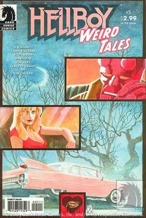<a href="J.H._Williams_III" title="wikilink">J.H. WILLIAMS III</a>
</td>
<td>
<em><a href="Love_is_Scarier_than_Death" title="wikilink">Love is Scarier than Death</a></em>
</td>
<td>
<a href="J.H._Williams_III" title="wikilink">J.H. Williams III</a> &amp; <a href="Haden_Blackman" title="wikilink">Haden Blackman</a>
</td>
<td>
<a href="J.H._Williams_III" title="wikilink">J.H. Williams III</a>
</td>
<td rowspan="4">
Pin-up by <a href="Cameron_Stewart" title="wikilink">Cameron Stewart</a>
</td>
</tr>
<tr class="odd">
<td>
<em><a href="Cool_Your_Head" title="wikilink">Cool Your Head</a></em>
</td>
<td colspan="2">
<a href="Scott_Morse" title="wikilink">Scott Morse</a>
</td>
</tr>
<tr class="even">
<td>
<em><a href="Shattered" title="wikilink">Shattered</a></em>
</td>
<td>
<a href="Ron_Marz" title="wikilink">Ron Marz</a>
</td>
<td>
<a href="Jim_Starlin" title="wikilink">Jim Starlin</a>
</td>
</tr>
<tr class="odd">
<td>
<em><a href="Doc_Hollow&#39;s_Grand_Vibro-Destructo_Machine" title="wikilink">Doc Hollow's Grand Vibro-Destructo Machine: Episode 5</a></em>
</td>
<td colspan="2">
<a href="John_Cassaday" title="wikilink">John Cassaday</a>
</td>
</tr>
<tr class="even">
<td rowspan="4">
6
</td>
<td rowspan="4">
December 10, 2003
</td>
<td rowspan="4">
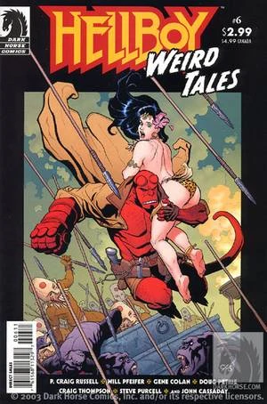<a href="Frank_Cho" title="wikilink">FRANK CHO</a>
</td>
<td>
<em><a href="Command_Performance" title="wikilink">Command Performance</a></em>
</td>
<td>
<a href="Will_Pfeifer" title="wikilink">Will Pfeifer</a>
</td>
<td>
<a href="P._Craig_Russell" title="wikilink">P. Craig Russell</a>
</td>
<td rowspan="4">
Pin-up by <a href="Steve_Purcell" title="wikilink">Steve Purcell</a>
</td>
</tr>
<tr class="odd">
<td>
<em><a href="Friday" title="wikilink">Friday</a></em>
</td>
<td>
<a href="Doug_Petrie" title="wikilink">Doug Petrie</a>
</td>
<td>
<a href="Gene_Colan" title="wikilink">Gene Colan</a>
</td>
</tr>
<tr class="even">
<td>
<em><a href="My_Vacation_in_Hell" title="wikilink">My Vacation in Hell</a></em>
</td>
<td colspan="2">
<a href="Craig_Thompson" title="wikilink">Craig Thompson</a>
</td>
</tr>
<tr class="odd">
<td>
<em><a href="Doc_Hollow&#39;s_Grand_Vibro-Destructo_Machine" title="wikilink">Doc Hollow's Grand Vibro-Destructo Machine: Episode 6</a></em>
</td>
<td colspan="2">
<a href="John_Cassaday" title="wikilink">John Cassaday</a>
</td>
</tr>
<tr class="even">
<td rowspan="4">
7
</td>
<td rowspan="4">
February 11, 2004
</td>
<td rowspan="4">
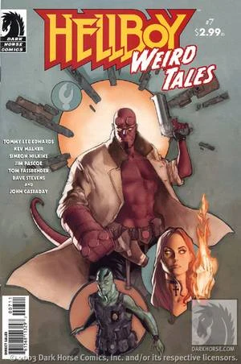<a href="Phil_Noto" title="wikilink">PHIL NOTO</a>
</td>
<td>
<em><a href="A_Love_Story" title="wikilink">A Love Story</a></em>
</td>
<td>
<a href="Tommy_Lee_Edwards" title="wikilink">Tommy Lee Edwards</a>
</td>
<td>
<a href="Tommy_Lee_Edwards" title="wikilink">Tommy Lee Edwards</a> with <a href="Don_Cameron" title="wikilink">Don Cameron</a>
</td>
<td rowspan="4">
Pin-up by <a href="Dave_Stevens" title="wikilink">Dave Stevens</a>
</td>
</tr>
<tr class="odd">
<td>
<em><a href="Theater_of_the_Dead" title="wikilink">Theater of the Dead</a></em>
</td>
<td>
<a href="Jim_Pascoe" title="wikilink">Jim Pascoe</a> &amp; <a href="Tom_Fassbender" title="wikilink">Tom Fassbender</a>
</td>
<td>
<a href="Simeon_Wilkins" title="wikilink">Simeon Wilkins</a>
</td>
</tr>
<tr class="even">
<td>
<em><a href="Long_Distance_Caller" title="wikilink">Long Distance Caller</a></em>
</td>
<td colspan="2">
<a href="Kev_Walker" title="wikilink">Kev Walker</a>
</td>
</tr>
<tr class="odd">
<td>
<em><a href="Doc_Hollow&#39;s_Grand_Vibro-Destructo_Machine" title="wikilink">Doc Hollow's Grand Vibro-Destructo Machine: Episode 7</a></em>
</td>
<td colspan="2">
<a href="John_Cassaday" title="wikilink">John Cassaday</a>
</td>
</tr>
<tr class="even">
<td rowspan="4">
8
</td>
<td rowspan="4">
April 14, 2004
</td>
<td rowspan="4">
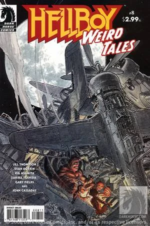<a href="Michael_W._Kaluta" title="wikilink">MICHAEL W. KALUTA</a>
</td>
<td>
<em><a href="Fifteen_Minutes..." title="wikilink">Fifteen Minutes...</a></em>
</td>
<td colspan="2">
<a href="Jill_Thompson" title="wikilink">Jill Thompson</a>
</td>
<td rowspan="4">
Pin-up by <a href="Gary_Fields" title="wikilink">Gary Fields</a>
</td>
</tr>
<tr class="odd">
<td>
<em><a href="Toy_Soldier" title="wikilink">Toy Soldier</a></em>
</td>
<td>
<a href="Akira_Yoshida" title="wikilink">Akira Yoshida</a> &amp; <a href="Kia_Asamiya" title="wikilink">Kia Asamiya</a>
</td>
<td>
<a href="Kia_Asamiya" title="wikilink">Kia Asamiya</a>
</td>
</tr>
<tr class="even">
<td>
<em><a href="Professional_Help" title="wikilink">Professional Help</a></em>
</td>
<td colspan="2">
<a href="Evan_Dorkin" title="wikilink">Evan Dorkin</a>
</td>
</tr>
<tr class="odd">
<td>
<em><a href="Doc_Hollow&#39;s_Grand_Vibro-Destructo_Machine" title="wikilink">Doc Hollow's Grand Vibro-Destructo Machine: Episode 8</a></em>
</td>
<td colspan="2">
<a href="John_Cassaday" title="wikilink">John Cassaday</a>
</td>
</tr>
</tbody>
</table>

## Collected Editions

The series has been collected in two trade paperbacks and a single hardcover omnibus.

### Trade Paperback Collections

Each of the two trade paperbacks collect four sequential individual *Hellboy: Weird Tales* issues.

<table>
<thead>
<tr class="header">
<th>
Volume
</th>
<th>
Title
</th>
<th>
Date Published
</th>
<th>
Cover
</th>
<th>
Material Collected
</th>
</tr>
</thead>
<tbody>
<tr class="odd">
<td>
1
</td>
<td>
<em>Hellboy Weird Tales: Volume 1</em>
</td>
<td>
December 17, 2003
</td>
<td>
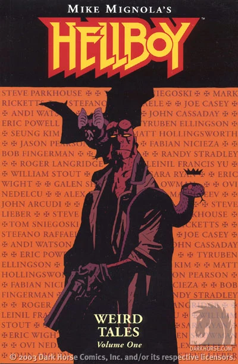MIKE MIGNOLA
</td>
<td>
<em>Hellboy Weird Tales</em> #1–4
</td>
</tr>
<tr class="even">
<td>
2
</td>
<td>
<em>Hellboy Weird Tales: Volume 2</em>
</td>
<td>
October 27, 2004
</td>
<td>
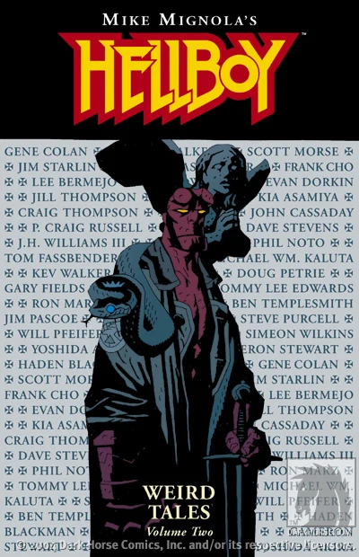MIKE MIGNOLA
</td>
<td>
<em>Hellboy Weird Tales</em> #5–8
</td>
</tr>
</tbody>
</table>

### Hardcover Omnibus Collection

In addition to collection *Hellboy: Weird Tales* \#1–8, the *Hellboy: Weird Tales* omnibus edition also features two canonical stories *[How Koshchei Became Deathless](/entry/How%20Koshchei%20Became%20Deathless)* and *[Baba Yaga's Feast](/entry/Baba%20Yaga%27s%20Feast)*. The eight-episode story *[Doc Hollow's Grand Vibro-Destructo Machine](/entry/Doc%20Hollow%27s%20Grand%20Vibro-Destructo%20Machine)* was retitled "*Lobster Johnson: Action Detective Adventure*" for this collection.

<table>
<thead>
<tr class="header">
<th>
Title
</th>
<th>
Date Published
</th>
<th>
Cover
</th>
<th>
Material Collected
</th>
<th>
Additional Material
</th>
</tr>
</thead>
<tbody>
<tr class="odd">
<td>
<em>Hellboy: Weird Tales</em>
</td>
<td>
November 26, 2014
</td>
<td>
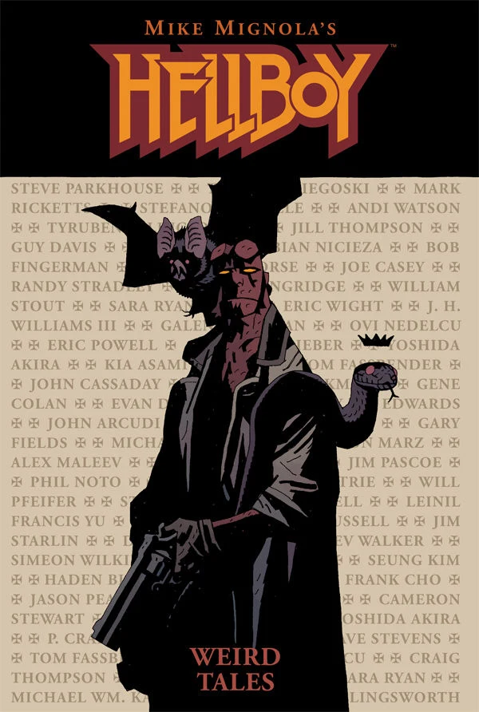MIKE MIGNOLA
</td>
<td><ul>
<li><em>Hellboy Weird Tales</em> #1–8</li>
<li><em><a href="How_Koshchei_Became_Deathless" title="wikilink">How Koshchei Became Deathless</a></em></li>
<li><em><a href="Baba_Yaga&#39;s_Feast" title="wikilink">Baba Yaga's Feast</a></em></li>
</ul></td>
<td>
Forward by <a href="Scott_Allie" title="wikilink">Scott Allie</a>
</td>
</tr>
</tbody>
</table>

## External Links

- [*Hellboy: Weird Tales \#1* product page on DarkHorse.com](https://www.darkhorse.com/Comics/11-329/Hellboy-Weird-Tales-1)
- [*Hellboy: Weird Tales \#2* product page on DarkHorse.com](https://www.darkhorse.com/Comics/11-333/Hellboy-Weird-Tales-2)
- [*Hellboy: Weird Tales \#3* product page on DarkHorse.com](https://www.darkhorse.com/Comics/11-336/Hellboy-Weird-Tales-3)
- [*Hellboy: Weird Tales \#4* product page on DarkHorse.com](https://www.darkhorse.com/Comics/12-313/Hellboy-Weird-Tales-4)
- [*Hellboy: Weird Tales \#5* product page on DarkHorse.com](https://www.darkhorse.com/Comics/12-471/Hellboy-Weird-Tales-5)
- [*Hellboy: Weird Tales \#6* product page on DarkHorse.com](https://www.darkhorse.com/Comics/12-472/Hellboy-Weird-Tales-6)
- [*Hellboy: Weird Tales \#7* product page on DarkHorse.com](https://www.darkhorse.com/Comics/12-473/Hellboy-Weird-Tales-7)
- [*Hellboy: Weird Tales \#8* product page on DarkHorse.com](https://www.darkhorse.com/Comics/12-474/Hellboy-Weird-Tales-8)
- [*Hellboy: Weird Tales Volume 1* product page on DarkHorse.com](https://www.darkhorse.com/Books/11-341/Hellboy-Weird-Tales-Volume-1-TPB)
- [*Hellboy: Weird Tales Volume 2* product page on DarkHorse.com](https://www.darkhorse.com/Books/12-480/Hellboy-Weird-Tales-Volume-2-TPB)
- [*Hellboy: Weird Tales* Omnibus product page on DarkHorse.com](https://www.darkhorse.com/Books/24-712/Hellboy-Weird-Tales-HC)

**Category:Comics**