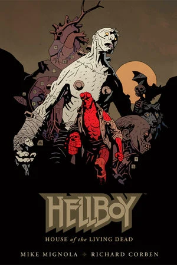

## Publication History

*House of the Living Dead* is the first Hellboy original graphic novel. The story was first published in hardcover format in November 2011. It is collected in the [*Hellboy in Mexico*](/entry/TPB) trade paperback.

## Synopsis

Devastated over the loss of his luchador comrade to vampires, Hellboy lingers in Mexican bars until he's invited to participate in the ultimate wrestling match with a vicious Frankenstein monster.

## Notes

- The back cover incorrectly dates this story taking place in 1952. Hellboy's time in Mexico is during 1956.

**Category:Story** **Category:Hellboy story**