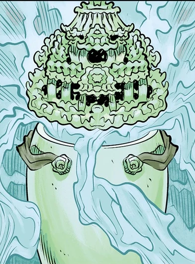

 A **hunping** is a Chinese vessel in which a dead person's soul resides after being judged worthy to escape punishment in the afterlife.

## Description

The [Golden Crane Society](/entry/Golden%20Crane%20Society) possessed a millennia old hunping to combat supernatural dangers in China. The Society used it to trap demons and ghosts terrorizing the countryside.

## History

In 1953, to avoid having the hunping being taken by the Communists, the Society charged one of its members, Bao Zhi to safeguard it in Kowloon Walled City. There he was to meet with two representatives from the [Special Intelligence Directorate](/entry/Special%20Intelligence%20Directorate), who would ensure its safety out of the country. However, one of the agents, Thomas Rhymes, went rogue to claim the artifact for himself. He injured his partner Margery and took Bao Zhi captive to understand its secrets.

[Lady Cynthia Eden-Jones](/entry/Lady%20Cynthia%20Eden-Jones), an old friend of [Professor Trevor Bruttenholm](/entry/Trevor%20Bruttenholm) and a high ranking member of the S.I.D. reached out and convinced him to send out a [B.P.R.D.](/entry/Bureau%20for%20Paranormal%20Research%20and%20Defense) team under the ruse of reclaiming a valuable artifact for her. The B.P.R.D. sent a team of agents composed of [Hellboy](/entry/Hellboy), [Woodrow Farrier](/entry/Woodrow%20Farrier), and [Susan Xiang](/entry/Susan%20Xiang) met with Roland Childe who was Lady Eden-Jones contact worked together to track down the artifact.

In Kowloon Walled City, Thomas used the hunping to steal the spirits of the dead visiting for the Ghost Moon Festival, and also the souls of the inhabitants. The demons of Hell, [Ox-Head and Horse-Face](/entry/Ox-Head%20and%20Horse-Face) detecting the spiritual disturbance entered the human world, but were unable to retrieve the souls stolen by Rhymes due to the powerful warding that kept them out. Both groups ran afoul with each other and a fight ensued. Susan with the help of a dying Bao Zhi, managed to steal back the hunping and ordered Hellboy to destroy it. The vessel was destroyed and allowing Ox-Head and Horse-Face to return the spirits back to their proper places.

## Abilities

Unlike normal hunpings this one was capable of containing not just one soul but a multitude. In the wrong hands it could also trap the souls of the living, with enough spiritual energy harassed it could be converted into a spiritual battery making one a god.

**Category:Items**