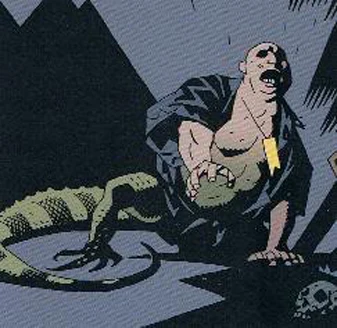

**Igor Bromhead** was what we could call a Dark Occultist, one who trafficked with dark powers and performed dark services to discerning (duped) customers. He had three encounters with [Hellboy](/entry/Hellboy) and the [B.P.R.D.](/entry/B.P.R.D.), none of which ended well for him.

## History

Born as Igor Weldon Bromhead to prominent prestige in 1947, Bromhead ran away from his life of privilege at seventeen years old and fell to the experience of the psychedelic culture of 1960s San Francisco. However, instead of becoming part of the scene, Bromhead quickly exploited the hippie movement and established himself as a drug dealer, which he developed a reputation in the Bay Area. Bromhead's own upper-class background and his ability to deliver exotic substances gained him the attention of the occult community; in which he also profited  off of. Initially, Bromhead scoffed at the existence of the occult and supernatural until his encounter with "Professor" William Whitcomb made him realized that there was real, dangerous magic in the world.

Bromhead continued to con the wealthy and curious. By 1975, Bromhead became a middleman in a worldwide ring of smugglers, trafficking occult merchandise stolen from tombs and temples. His business attracted the attentions of the B.P.R.D., which kept a tab on the occult smuggler's ring in which he was involved. Hellboy ran into Bromhead more than once.

In February 1983, Bromhead arranged for the theft of a powerful magical object, the left ring finger of prominent Elizabethan magician John Dee. Bromhead had stolen the ring from the reliquary at a church that Hellboy was investigating and subsequently caught Bromhead, exposing a series of thefts and fraud that led to a fifteen-year jail sentence for the con man. Throughout his life in prison, Bromhead led a hard life that drove him to turn to the black arts for protection, and he earnestly studied magic until his release in 1998. Thereafter, Bromhead decided to retire from his smuggling business after having one final score that would finance his retirement.

His connection in the black market led him to squeezing money from Count and Countess Guarino in Scotland, whom Bromhead saw as his ticket to wealth. The Guarinos, who were devout Satanists, squandered their money on Bromhead to see the devil in their lifetimes. Bromhead continued his deceptions for months until he knew that he must summon an actual demon to placate the Guarinos. Recalling a story from his smuggling days about a minor demon whom St. Dunstan had imprisoned in an iron box, Bromhead obtained the box and, as a measure of protection, learned the demon's true name - [Ualac](/entry/Ualac).

When Bromhead told the Guarinos that the box contained Satan himself, the Guarinos eagerly traded their remaining wealth for the box, believing that they would be rewarded for releasing the demon. But Bromhead witnesses the Countless becomes a vessel for Ualac while the Count is transformed into a monkey. He uses a charm Of St. Dunstan to protect himself from being turned into a lizard. From there, Bromhead uses the demon's true name and iron tongs that St. Dunstan originally owned to trap Ualac so be granted great wealth and power. The demon replied that there was a treasure hidden in the basement of the house Bromhead owned, and that, if he wanted true power, he would help the demon trap Hellboy, from whom Ualac wanted to take the Crown of the Apocalypse.

 After luring Hellboy and his companion [Abraham Sapien](/entry/Abraham%20Sapien) to the Guarino home shortly after Ualac was set free, Bromhead used Hellboy's secret name - provided by Ualac - to gain power over him while using a spell Ualac taught him to manifest Hellboy's hidden crown. Once Ualac took the crown, Bromhead attempted to have his revenge on Hellboy until Ualac stopped him to get the Right Hand of Doom. When Hellboy eventually freed himself, Bromhead attempted to flee before finding himself chased by Abe. Locking himself away from Abe, Bromhead calls on [Astaroth](/entry/Astaroth) for assistance. But Bromhead learned too late that struggle against Abe caused the bottom half of Bromhead's St. Dunstan charm broke off. Without the charm's full protection, the act of summoning Astaroth causes the curse that Ualac had tried to put on Bromhead took partial effect, leaving the con man's lower half of his body transformed into a lizard's. The now deformed Bromhead was only able to escape capture by hiding in the secret treasure-laden passageways under the Guarino mansion, securing enough of the Guarinos' riches to finance his retirement while setting his sights on gaining the power to lash out at a world that he blamed for his misfortunes.

Through his contacts in occult circles and in the black market, Bromhead learned about the skeleton of [Vladimir Giurescu](/entry/Vladimir%20Giurescu), which had been stolen from a Romanian airport several years before. In 1999, Bromhead spent his sizable fortunes to acquire the skeleton, and to have it brought to the catacombs near Lucca, Italy, where Bromhead was living in secret. With little practice in necromancy, Bromhead took years to contact Giurescu's spirit, and to recall that spirit into the bones. The spirit told Bromhead everything that had happened at Castle Giurescu in 1997 about [Ilsa Haupstein](/entry/Ilsa%20Haupstein)'s death and her iron maiden-encased body now occupied by [Hecate](/entry/Hecate).

In March 2006, Bromhead killed his servants in a blood offering to summon Hecate, and then used Ilsa Haupstein's name to trap the goddess in order to take her power for himself and become the lord over the witches of the world. However, Hecate's power overwhelmed Bromhead, mutating him further into an elongated moon-yellow man/lizard monster. Bromhead remained hidden near Lucca until Hellboy finally tracked him down. Bromhead begged Hellboy to kill him and end his misery, which Hellboy complied. As he died, Bromhead described a vision of Hell - with Hellboy astride a dragon, at the head of an army - and that he would meet Hellboy again in Hell, thus denoting that he'd not given up his desire for revenge against Hellboy.

## Powers and abilities

Igor Bromhead was well versed in the occult and had sworn service to [Astaroth](/entry/Astaroth). He had enough power to craft things such as the Hand of Glory, commanding a lesser demon through use of its true name and summon the reborn Hecate before stripping her of her powers. However, he was unable to effect a cure for his cursed deformity or to enjoy the fruits of his labors.

## Trivia

- According to Mike Mignola, Igor Bromhead's design was influenced by actor Peter Lorre.

**Category:Villains** **Category:Characters** **Category:Humans** **Category:Occultists** **Category:Male Characters** **Category:Deceased Characters** **Category:Hellboy characters**