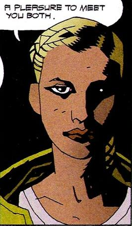

**Inger von Klempt** was the granddaughter of [Herman von Klempt](/entry/Herman%20von%20Klempt).

## History

Inger was contacted by her grandfather, who convinced her to help his plan to contact [Ernst Oeming](/entry/Ernst%20Oeming)'s space capsule and recall it to Earth. Inger believed that fulfilling the Third Reich's original plan would grant her and her men great power, as well as accomplish the ideals of Nazism, which she seems to have shared.

Masquerading as **Laura Karnstein**, an officer of the Austrian police, she offered to guide [Hellboy](/entry/Hellboy%20%28character%29) and [Roger](/entry/Roger) to the ruin of Hunte Castle, where Oeming's capsule had been launched from during World War II. Soon after they arrived, however, [The Lobster](/entry/The%20Lobster) appeared and revealed Inger's true identity.

When the capsule arrived, Inger donned a gas mask at her grandfather's command. She was horrified to see a gas emanating from the capsule that transformed her men into mindless reptilian beasts, which were swiftly devoured by the [Conqueror Worm](/entry/Conqueror%20Worm%20%28Ogdru%20Hem%29), a malevolent Ogdru Hem who had inhabited Oeming's dead body in space.

Inger fled the launch pad and hid inside the castle ruins. When Herman found her, he explained that he had lost interest in the goals of the Third Reich and and was tired of the endless defeats he had suffered, especially by Hellboy. Therefore, he had assisted the Conqueror Worm's return to Earth not to gain power, but simply to destroy the world. As for Inger, he confided that her gas mask had not protected her from the effects of the gas, only reduced its effects. Inger removed her mask and saw that she had been mutated into a reptile-like beast, only just capable of speech and independent thought. Herman said he wanted her to be aware enough to witness the coming apocalypse for herself.

As she wandered the ruins in despair, [Grigori Rasputin](/entry/Grigori%20Rasputin) appeared to her, confirming Herman's belief that there was no hope of reviving the Third Reich, or stopping the Worm, but also convincing her that she would be the first of a new race of humans that would rule the newly-cleansed world. However, she was soon found by the Lobster. To him she defiantly declared, "I am the future!" In response, he shot her several times, killing her, and burned the image of his claw into her forehead.

## Character and abilities

As a human, Inger von Klempt had received at least some training similar to a police or military official's. She was, however, a poor actress, with Hellboy, Roger and the B.P.R.D. seeing through her disguise fairly quickly.

As a mutated humanoid she seems to have lost some of her anxiety, but none of her gullibility. Though presumably tougher than when she was human, she was still easily dispatched by The Lobster.

**Category:Characters** **Category:Nazi** **Category:Deceased Characters** **Category:Female Characters** **Category:Humans** **Category:Villains**