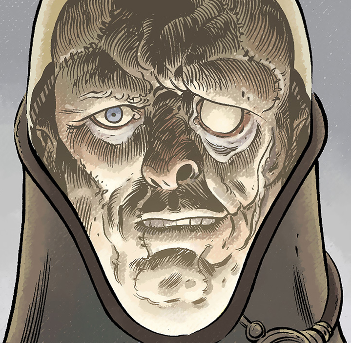

**Iosif Nichayko** is the current Director of Russia's [Special Sciences Service](/entry/Special%20Sciences%20Service).

## History

In 1948, Iosif, a Soviet soldier, volunteered for duty with Russia's [Special Sciences Service](/entry/Special%20Sciences%20Service). [Varvara](/entry/Varvara), Director of the SSS tasked him with protecting [Melchiorre's burgonet](/entry/Melchiorre%27s%20burgonet) while it was transported by submarine. He died, along with the rest of the crew, when the submarine was sunk.

[Abe Sapien](/entry/Abe%20Sapien) encountered his corpse in August 1984 when he was sent to recover Melchiorre's Burgonet from the sunken submarine. Iosif seemed to be a mindless zombie, only interested in protecting the burgonet. Abe left Iosif and the burgonet in the submarine, just before the Russian authorities launched their own recovery mission.

Iosif was taken by the S.S.S. and for a while remained unresponsive. Over time, however, he began to regain awareness. He became smarter and more ambitious, moreso than he ever was in life, eventually becoming Director of the SSS after overthrowing Varvara (whom Iosif now keeps imprisoned in a glass case in his office, alongside a few relics from his previous life).

Iosif has proven himself a very capable leader, albeit a deceitful one. 

## Abilities and attributes

- Superhuman Strength - capable of tearing through a giant metal door
- "Intimacy with death and the supernatural no one else in the Service can claim" - own words

**Category:Russians** **Category:Undead** **Category:Male Characters** **Category:Fictional characters with superhuman strength** **Category:Deceased Characters**