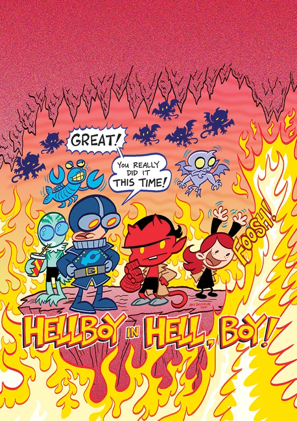

***Itty Bitty Hellboy*** is an out-of-continuity children's comic book spin-off created by Art Baltazar and Franco Aureliani.

## Publication History

### C2E2 Announcement

***Aw Yeah Comics* and *Tiny Titans* creators Art Baltazar and Franco Aureliani take on Mike Mignola’s cast of characters in a brand-new all-ages title!**

CHICAGO, IL, APRIL 27–Art Baltazar and Franco Aureliani have created quite a stir with their work on some of the most fun and ageless comics of all time. They won an Eisner for *Tiny Titans*, their treatment of DC Comics’ *Teen Titans*, and their recent Kickstarter campaign for their *Aw Yeah Comics* series surpassed its goal in record time.

Now, this dynamic duo takes on Dark Horse’s best-known character, Mike Mignola’s Hellboy, in an all-new comics series, *Itty Bitty Hellboy*!

A ghost named Rasputin has been spotted. And Hellboy and the B.P.R.D. are going to find out what’s he up to. Who is Hellboy, anyway? Why does he have such a big hand, and what is it used for? Who’s weirder, he or his friends? What is the B.P.R.D.? And what does *chicken soup* have to do with all of it? All this and more will be answered in the debut issue, where BIG things happen to *Itty Bitty Hellboy*!

“Itty Bitty HELLBOY! WOW! Such awesomeness! I haven’t screamed so much AW YEAH SHOUTOUTS in all my life! It is truly an honor to be the next creative team to add to the HELLBOY saga! I have been a fan of Mike Mignola since Hellboy’s early days at Dark Horse LEGENDS! It’s true. Can’t wait! Itty Bitty has never been so HUGE! AW YEAH HELLBOY!” said Art Baltazar, famous cartoonist.

“We get to work on HELLBOY? HELL YEAH!” exclaimed Franco Aureliani. “One of the most iconic characters in all of comics, and we get to bring our own style and story to it! Truly a dream come true! We’re big fans! Itty Bitty Hellboy is going to be a lot of fun . . . and we get to actually say HELL(BOY)!”

“Given the recent developments in Hellboy’s life—falling in love, discovering that he’s the rightful king of England, having his heart torn out and dropped into hell—this is clearly the next logical step in his evolution,” said Hellboy creator Mike Mignola.

*Itty Bitty Hellboy* \#1 arrives on shelves at your local comic shop on August 28!

## Synopsis

### Issue One

A ghost named Rasputin has been spotted! And Hellboy and the B.P.R.D. are going to find out what he’s up to.

Who is Hellboy anyway? Why does he have such a big hand and what is it used for? Who's weirder, him or his friends? What is the B.P.R.D.? And what does **chicken soup** have to do with all of it? This and more answered in the debut issue, where BIG things happen to itty bitty Hellboy!

### Issue Two

Lobster Johnson is on the trail of a Squatch!

His search has led him to the deep woods, and Hellboy and the B.P.R.D. are going to help him the best way they know how! That's right—it’s a camping trip! One thing is for sure: when Liz is around you never need a flashlight, but you might need to bring your own marshmallows!

### Issue Three

It had to happen! Because you demanded it! Hellboy and the gang go to the fiery pits of HELL! How did they get there anyway? ALSO, our B.P.R.D. heroes’ search for Sasquatch continues! But what does Rasputin have to do with all this? OOOOH! Is he just trying to scare us? You WILL find out in this exciting issue!!!

### Issue Four

What comes down must go UP! All the way up to the heavens! That's right! Things may never be the same for Itty Bitty Hellboy and his pals after Roger tries to make friends with the Baba Yaga! What? Doesn't she like flowers? Maybe it's just Roger she finds irritating. Roger may be feeling separation anxiety after this story! Prepare yourself for the fluffiest, cloudiest, heavenliest issue yet!

### Issue Five

It had to happen. It was unavoidable. Sooner or later, we all end up there. That’s right! It’s time to visit our friend who lives underwater! Let’s go hang out with Abe Sapien! Are Hellboy and his pals underwater by choice? Or did something more sinister send them to the cold, lagoony depths? We know one thing: Abe does not mind the company! And where is Lobster Johnson during this visit? When all is said and done, sometimes a beach party is the best way to go... even if you happen to be in the swamp.

## Gallery

文件:Itty Bitty Hellboy 1.jpg|Issue \#1 文件:Itty Bitty Hellboy 1 Variant.jpg|Issue \#1 variant 文件:Itty Bitty Hellboy 2.jpg|Issue \#2 文件:Itty Bitty Hellboy 3.jpg|Issue \#3 文件:Itty Bitty Hellboy 4.jpg|Issue \#4 文件:Itty Bitty Hellboy 5.jpg|Issue \#5

**Category:Out-of-continuity story**