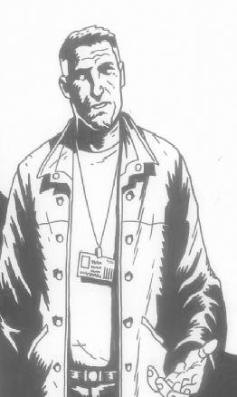

Dr. **Izar Hoffman** is a [B.P.R.D.](/entry/B.P.R.D.) agent and psychic. He is irst mentioned in the final panels of *[The Wolves of Saint August](/entry/The%20Wolves%20of%20Saint%20August)*, Hoffman made his first on panel appearance in *[B.P.R.D.: The Ectoplasmic Man](/entry/The%20Ectoplasmic%20Man)*.

## History

### *[The Wolves of Saint August](/entry/The%20Wolves%20of%20Saint%20August)*

In the final panels of the Hellboy story: *The Wolves of Saint August*, a short official B.P.R.D. summary concludes the case. A follow up investigation to the village of Griart is mentioned to have failed to detect any traces of Father Edward Kelly or the ghosts of the Grenier family. The site is declared clear by Dr. Izar Hoffman on May 29th, 1994. This is Dr. Hoffman's first mention in the Hellboy continuity and suggests he is a senior, or high ranking B.P.R.D. agent capable of leading Psychic investigation teams.

### [Wake the Devil](/entry/Wake%20the%20Devil)

Dr. Hoffman briefly appears in the first issue of the Hellboy story: *Wake the Devil*.  B.P.R.D. director Tom Manning explained that Dr. Hoffman's psychics had examined the wax museum storage room owned by [Hans Ubler](/entry/Hans%20Ubler).  Hoffman reported that his people were upset by the atmoshpere of the place and several in particular described a tall, "evil-looking" man in a napoleonic uniform.  Hoffman concluded that [Vladimir Giurescu's](/entry/Vladimir%20Giurescu) body had been stored in the wax museum before being stolen.

### *[The Ectoplasmic Man](/entry/The%20Ectoplasmic%20Man)*

In the BPRD one-shot, *The Ectoplasmic Man*, Hoffman makes his first on panel appearance. In Heidelberg, Germany in 2002, Hoffman is summoned by Jurgen, a German police inspector to the scene of a seance gone wrong. There, thanks to his psychic abilities, Hoffman is able to see the ectoplasmic form of [Johann Kraus](/entry/Johann%20Kraus), and discern the nature of the incident which destroyed Johann's clients the Wagner family as well as Johann's physical body. He tells Johann about the events in Chengdou, which lead to a backlash on the psychic plane and advises Johann to 'move on' or let the B.P.R.D. help him. After Johann has fled the scene consumed by guilt, Hoffman is reluctant to close the scene of the incident and give up on Johann. Johann eventually returns and Hoffman facilitates Johann's induction into the B.P.R.D. In a B.P.R.D. lab Hoffman watches Johann receive his first containment suit and demonstrate his ability to give temporary forms to the dead.

Dr. Hoffman has yet to make any more appearances in the Hellboy/B.P.R.D. comics but is presumably still active as an agent. His familiarity with Jurgen the German inspector and passing references to previous cases in Germany as well as previously meeting Johann before in Berlin in 2001 suggest he was operating in Germany on a permanent basis.

### Other Appearances

In the official 'Hellboy Sourcebook and roleplaying game (2002)' Dr. Hoffman is mentioned to be the director of the B.P.R.D. research department and although not a psychic himself, an expert on enhanced talents. He is described as in his 50's, dark haired and balding. This description of Hoffman, seems at odds with his later appearance in *The Ectoplasmic Man*. In this instance it can probably be assumed that the Sourcebook and Roleplaying game is not in continuity, or is non-cannon.

## Powers and Abilities:

Dr. Hoffman refers to himself as a psychic, although the true nature and range of his abilities are unknown. He at least demonstrates a psychic sensitivity above that of baseline humans, as he was able to see and converse with Johann's spirit in *The Ectoplasmic Man.*

**Category:Male Characters** **Category:Humans** **Category:B.P.R.D. agent** **Category:Psychics**