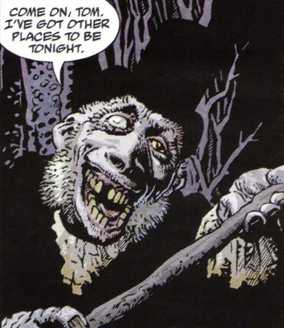
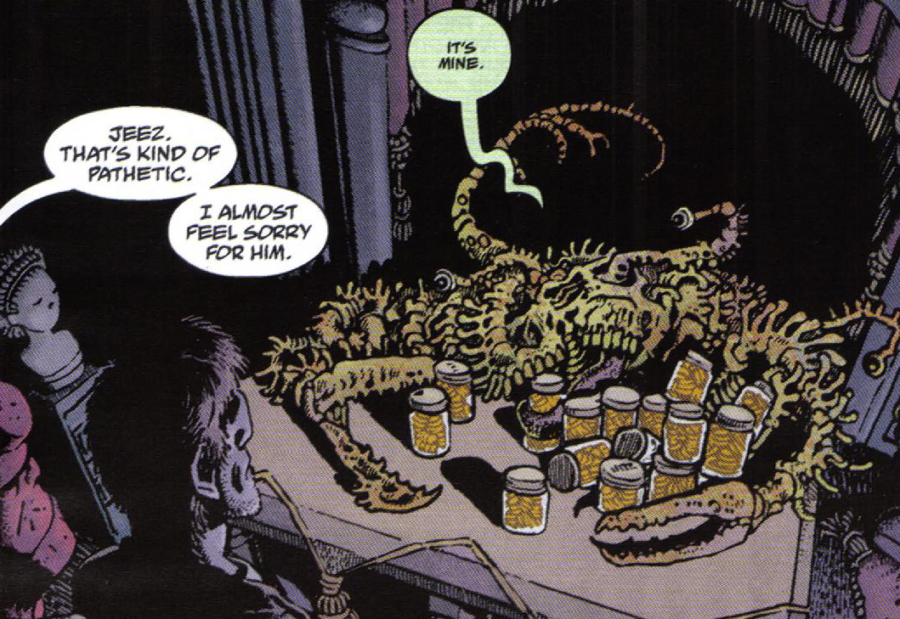

 **Jeremiah Witkins**, a.k.a. **The Crooked Man** is the main villain of the [Hellboy](/entry/Hellboy) [story of the same name](/entry/The%20Crooked%20Man).

## History

According to local legend, **Jeremiah Witkins** was one of the first settlers in the Appalachian Mountains of Virginia. He built his house in an area called The Hurricane. He was also one of the worst men in his lifetime, amassing his fortune from the misery of others. Stirring conflict between his fellow settlers and the native tribes, he sold liquor and guns to both sides, during both the American Revolution and the Civil War. Witkins was eventually hanged for his crimes, and his fortune was dispersed to the winds, but his name and memory became cursed among the locals. However, because of his impressive record of sin, "[the Devil](/entry/Satan)" sent Witkins back to the mortal world as a demonic soul collector.

Now known as the Crooked Man, Witkins recruited the witch [Effie Kolb](/entry/Effie%20Kolb) as his right-hand woman while turning local women into witches by preying on them during the low ebbs of their lives. He collected souls in glass jars, where they took the appearance of gold coins.

When he was a boy, [Tom Ferrell](/entry/Tom%20Ferrell) was seduced by Effie Kolb, who convinced him to make a [Lucky cat bone](/entry/Lucky%20cat%20bone) with a Satanic ritual. Yet on his way home from completing the ritual, Tom saw The Crooked Man watching him from the woods, and ran home in terror, swearing never to use the bone's power.

In 1958, while on their way to a rural church to bury the body of his father, Tom and [Hellboy](/entry/Hellboy%20%28character%29) were attacked on the road by Witkins' minions, and fought them off, convincing Tom that he had, without wanting to, used the bone and thus completed his own damnation.

As they took refuge inside the church with [Reverend Watts](/entry/Reverend%20Watts), the Crooked Man hovered outside with Kolb and a host of witches, demanding that Tom "pay" his side of the bargain. Reverend Watts told Tom that he had never used the bone, that in spite of his youthful foolishness he was still a good man, and the Devil had no claim on him. Watts then challenged Witkins to come and "fetch" Tom himself, knowing that Witkins and his ilk could not cross the threshold of the church. As day broke, Reverend Watts consecrated the bone, turning it into a holy object, and did the same to a shovel, which Hellboy used to pulverize the Crooked Man's human form, causing Kolb and the other witches to flee.

Hellboy and Ferrell then went to Witkins's house in the Hurricane, and found him in his true demonic form: a twisted, crab-like creature hunched over his jars of gold, muttering, "it's mine... it's all mine..." Tom threw the lucky cat bone at him, causing the demon to disappear. Tom was unsure whether he had set the souls of Witkins' other victims free, or sent them down to Hell with him, but either way, the Crooked Man was finished.

## Appearance

 In life, Jeremiah Witkins was a tall Caucasian male, with long sideburns, one blinded eye and a grin that was anything but friendly, his crooked nature marking him physically. After his death and pact with the Devil, Witkins became a misshapen crab-like creature with multiple eyes that projects an image of his original form that is a more crooked with his head lolling to the side, slack-jawed with several teeth missing, a deathly pale cast to his flesh and his sideburns even more fuzz-like.

## Powers and abilities

As in life Jeremiah Witkins possessed in death his abilities to capitalize on misery, to drive hard bargains and to corrupt others to his way of thinking. He had gained in death the ability to teach witchcraft to others, give at least one [person](/entry/Effie%20Kolb) eternal youth, telekinesis, the making of illusions and to raise as undead some sinners buried in the churchyard. Most likely he also had a direct hand in the crafting of such magic items as Tom's [Lucky cat bone](/entry/Lucky%20cat%20bone), the [Magic horse's bit](/entry/Magic%20horse%27s%20bit) and the [Witch balls](/entry/Witch%20ball).

## Trivia

- Miser Witkins was at least partially based off the old English children's rhyme "There was a crooked man".
- One of the panels depicting him in life shows him handing (with a smile) a gun and a bottle to an Indian. This is a stereotypical depiction of what some unscrupulous people did up until the late 1800's.
- His demonic form is obviously a reference to [Mr. Krabs](http://en.spongepedia.org/index.php?title=Eugene_H._Krabs) of the cartoon show "SpongeBob SquarePants" whom is also a miserly hoarder of wealth.

**Category:Characters** **Category:Villains** **Category:Undead** **Category:Male Characters** **Category:Demons**