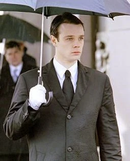

[John Myers](/entry/John%20Myers) was a B.P.R.D. agent that debuted in the [first *Hellboy* film](/entry/Hellboy%20%282004%20film%29), but has made no further appearances.

## Biography

### *[Hellboy](/entry/Hellboy%20%282004%20film%29)* (2004)

John Myers joins the Bureau of Paranormal Research and Defense in the beginning of the first movie. He is a transfer from the FBI, Quantico, and finds that his new job appeared to be at a 'Squeaky Clean Waste Management Services.' He presses the button labeled 103 and is quickly greeted by a fast voice. After he reveals who he is, a machine pops out of the speaker and takes a picture of John's eyes.

John Myers enters the building and is taken to Section 51. The character is used to introduce Abe Sapien, a human/fish who lives in Professor Trevor Broom's study. Myers remarked Abe was weird, also calling him it when asking how Abe knew so much about him. Myers also meets the main character, [Hellboy](/entry/Hellboy%20%28character%29).

Hellboy and Myers immediately begin a harsh relationship after the red demon finds out his liaison, Agent Clay, who he has known for years, is going to be replaced by a newbie.

Clay whispers information about Hellboy to Myers, in an attempt to avoid confusion and to better help the new 'nanny.' The information includes Hellboy's love for cats, his filed horns, and that his favorite candy, Baby Ruths, should be offered whenever Hellboy gets angry or in a bad mood.

Myers joins Hellboy and Abe on the first mission of the movie, when there is a break-in at the Machen Library where police and S.W.AT. are everywhere. Hellboy and Abe are delivered hiding in the back of a garbage truck. When John helps Hellboy, Hellboy remarks that nobody helps him. However, he eventually asked John to reload his gun when things are getting worse. Myers then had to keep a [Sammael](/entry/Sammael)'s egg sack that stuck on Hellboy's arm while Hellboy managed to shoot the creature with a tracker bullet. As he tries to catch up with Hellboy, John is struck by a car, and when another comes at him, Hellboy throws the car into the air, saving John in process.

After Hellboy defeats the creature, Myers calls Hellboy via his communication device, where Hellboy said that he wanted to visit someone, whom later revealed as [Liz Sherman](/entry/Liz%20Sherman). When he later learned her identity, John said that he would try to bring her back, despite the fact that Hellboy said that it won't improve their relationship. Meanwhile, as he successfully persuades Liz to return, Clay is killed by the infamous Nazi assassin, Kroenen while searching for another Sammael's nest within the city sewers, leaving Hellboy and injured Abe as the survivors. John is later seen ignoring Hellboy when Hellboy had a fight with Tom Manning, whom angered with Hellboy's reckless nature.

## *Hellboy II: The Golden Army*

In the second movie, Liz states that Hellboy had Myers "transferred to Antarctica."     de:John Myers

**Category:Hellboy (2004 film) characters**