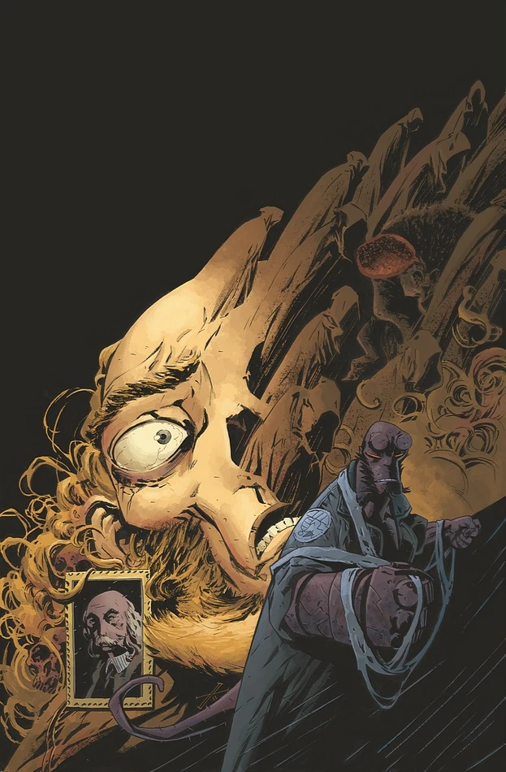

***《J·H·奥唐纳教授的转变》***（The Transformation of J.H. O'Donnell）是一部单篇漫画（one-shot），于 2012 年 5 月出版。

## 出版历史

《J·H·奥唐纳教授的转变》是《[人间炼狱](/entry/Hell_on_Earth_(story_cycle))》故事环的一部分，但属于支线故事，主要围绕回忆中的往事展开。封面由[马克斯·菲乌马拉](/entry/Max_Fiumara)（Max Fiumara）绘制，另附有一款[迈克·米格诺拉](/entry/Mike_Mignola)绘制的“[怪兽之年](/entry/Year_of_Monsters)”（Year of Monsters）变体封面。

## 剧情简介

二十四年前，[地狱男爵](/entry/Hellboy_%28character%29)曾带着性情温和的 [J·H·奥唐纳教授](/entry/James_Henry_O%E2%80%99Donnell)，进入一位新近去世的死灵法师的秘密藏书馆。自那天起，奥唐纳便成了防御署内的权威专家，专门研究那些一心想要终结人类时代的古老强大力量。在这场超自然惊悚之旅中，看看奥唐纳究竟看到了什么。

## 画廊

 \#1

**Category:Story** **Category:B.P.R.D. story** **Category:B.P.R.D.: Hell on Earth story**
