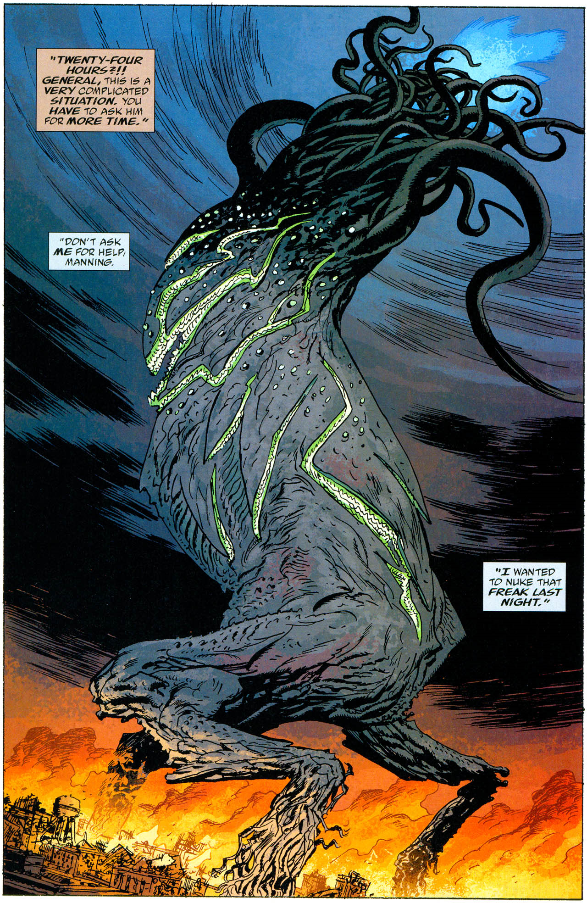

The **Katha-Hem** was one of the 369 Ogdru Hem, the children of the [Ogdru Jahad](/entry/Ogdru%20Jahad).

## History

Katha-Hem was the third of the Ogdru Hem to be set loose upon the world, and by far the most powerful. While [Sadu-Hem](/entry/Sadu-Hem) was foretold to bring about the Plague of frogs, the arrival of Katha-Hem was an indication that the world would begin to change.

Summoned out of the ether by the occult rituals of the frog monsters and CEO of [Zinco Corporation](/entry/Zinco%20Corporation) [Landis Pope](/entry/Landis%20Pope) (also known as the [Black Flame](/entry/The%20Black%20Flame%20%28character%29)), Katha-Hem towered as large as a mountain and began marching across the Midwestern United States. Atop a tripod of spidery legs, Katha-Hem resembled a twisted, tentacled tree, its canopy an inferno of hellish blue fire, and numerous green-toothed maws lining its trunk.

American artillery failed to make a dent in the mammoth creature, while any humans who ventured too close were turned into monsters by a strange green gas emitted from its body. Just as the U.S. President was about to resort to a nuclear strike, [B.P.R.D.](/entry/Bureau%20for%20Paranormal%20Research%20and%20Defense) agent [Liz Sherman](/entry/Liz%20Sherman) managed to burn Katha-Hem to ashes, using an [ancient artifact](/entry/Spiked%20Cylinder) that mysteriously amplified her powers a thousand times.

Katha-Hem's destruction (and the apparent mass suicide of the frog monsters) appeared to bring the plague of frogs to a conclusion.

## Gallery

Katha-Hem.png

**Category: The Ogdru Jahad and their Agents** **Category:Ogdru Hem** **Category:Deceased Characters**