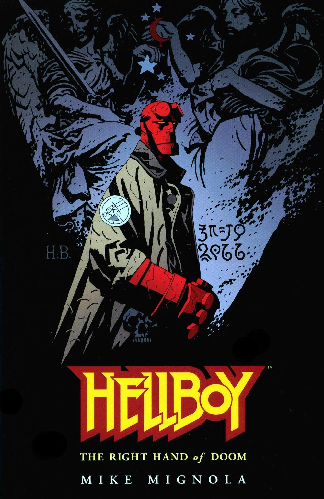

Hellboy and Prof. Aickman meet King Vold, the flying huntsman in Norway.

## Publication History

*King Vold* was specifically created for *[Hellboy: vol. 4 The Right Hand of Doom](/entry/TPB)*, published in April 2000.

## Synopsis

In 1956 [Hellboy](/entry/Hellboy) is asked by [Trevor Bruttenholm](/entry/Trevor%20Bruttenholm) to assist an associate, Prof. [Edmond Aickman](/entry/Edmond%20Aickman), in Norway. Hellboy agrees and travels there, where Aickman makes a good first impression by telling Hellboy a number of Norwegian folktales and demonstrating considerable knowledge of local mythology and paranormal events. The two travel to a remote, forested, mountainous location. Hellboy asks what they are doing there. Aickman replies that they are waiting for King Vold, doomed to hunt every night after making a blasphemous comment, though very few have ever seen him. The professor believes that Hellboy's presence and status as a demonic creature will increase their chances of meeting the King.

King Vold indeed appears and asks Aickman to watch over one of his wolves for the night, in return for a rich reward, before disappearing. Aickman has Hellboy 'handle' the wolf, promising Hellboy half of the gold reward from the King, while he himself stands back and observes. The wolf becomes a wolf-man and then a Viking berserker. The creature attacks Hellboy savagely, badly wounding the latter and knocking him unconscious, but Hellboy ultimately succeeds in preventing it from leaving. All the while, Aickman does nothing to help and is overtaken by delusions of fame and fortune. King Vold later returns with his catch and takes back his wolf. Aickman promptly claims sole credit for the feat, telling King Vold that Hellboy was a "servant" who had fainted as the King had appeared. King Vold 'honors' his promise to reward Aickman, but the coins burn through Aickman's hands and turn to stone when they hit the ground. The King wishes Hellboy, not Aickman, farewell, referring to him via his real name of 'Anung Un Rama,' before riding away. Hellboy wakes up, having missed the entire exchange.

Hellboy returns to Bruttenholm, and Aickman is shown reduced to begging for money in Copenhagen, Denmark.

## Story Chronology

The story takes place in 1956. In a box it is also said that [Trevor Bruttenholm](/entry/Trevor%20Bruttenholm) adopted [Hellboy](/entry/Hellboy) in 1946 and that Hellboy became a [B.P.R.D.](/entry/B.P.R.D.) field agent in 1952. The events of *[B.P.R.D.: 1946](/entry/1946)* occur shortly after the adoption.[1] Hellboy's start as a field agent in 1952 is also mentioned in *[The Wolves of Saint August](/entry/The%20Wolves%20of%20Saint%20August)*, *["Hi, My Name's Hellboy"]("Hi,_My_Name's_Hellboy" "wikilink")* and *[The Right Hand of Doom](/entry/The%20Right%20Hand%20of%20Doom)*.

## Connections to Other Stories

- King Vold is mentioned by name in *[The Wild Hunt](/entry/The%20Wild%20Hunt)* \#7.

<!-- -->

- The legend of King Vold is mentioned by [Kate Corrigan](/entry/Kate%20Corrigan) in the Animated film [Hellboy: Sword of Storms](/entry/Hellboy__Sword_of_Storms). The details of the legend are the same. However, in the movie it was Kate, not Hellboy, who investigated. Also she travels to Prague, not Norway.

<!-- -->

- Hellboy mentions his encounter with King Vold when he encounters Professor Aickmann again in Stockholm, in *[Hellboy: The Bones of Giants](/entry/Hellboy__The_Bones_of_Giants)*.

## Notes

<references/>
! colspan = 3 | [Vol. 4 The Right Hand of Doom](/entry/TPB)

**Category:Story** **Category:Hellboy story**

[1] *B.P.R.D. [1946](/entry/1946)* \#1, "Reluctant to leave **newly adopted ward**".