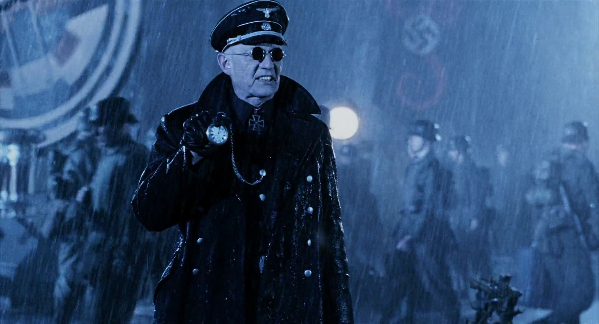

General **Klaus Werner von Krupt** was one of the division heads of [Project Ragna Rok](/entry/Project%20Ragna%20Rok) in the the final days of World War II.

## History

General Klaus Werner von Krupt was one of the primary members of [Project Ragna Rok](/entry/Project%20Ragna%20Rok), one of [Adolf Hitler](/entry/Adolf%20Hitler)'s Doomsday Projects, with the sole purpose of winning the Second World War for the Third Reich. Von Krupt was present during the "[Hellboy incident](/entry/Seed%20of%20Destruction)" and was highly skeptical about the sorcerer [Grigori Rasputin](/entry/Grigori%20Rasputin)'s promises of creating a miracle for the Third Reich. Von Krupt declared the project a failure when he failed to see results; little did he know that the sorcerer's ritual brought the humanoid demon, [Hellboy](/entry/Hellboy) to Earth. Following the war, von Krupt was interned in a mental hospital and died months later when his body was found infested with beetles of unknown species and origin.

## Other media/appearances

- In the film *[Hellboy](/entry/Hellboy%20%28film%29)*, von Krupt was portrayed by William Hoyland and is present at Rasputin's ritual. In the script, he is killed by the American soldiers storming the ritual site. In the film, von Krupt wears a pair of dark glasses, instead of a monocle, and neither lens is imprinted with a swastika, as the monocle is.
- In the short story "Jigsaw" by Stephen R. Bissette, collected in *[Hellboy: Odd Jobs](/entry/Hellboy%3A%20Odd%20Jobs)*, [Katherine Corrigan](/entry/Katherine_Corrigan)) mentions that several members of Project Ragna Rok, including von Krupt, [Leopold Kurtz](/entry/Leopold%20Kurtz), and [Ilsa Haupstein](/entry/Ilsa%20Haupstein) convened in Paris to reassemble the head of Moro, an evil alchemist executed by the Church in the 17th Century, but were interrupted by an attack from the French Underground before they could do so.

de:Klaus Werner von Krupt

**Category:Characters** **Category:Nazi** **Category:Minor Character** **Category:Male Characters** **Category:Germans** **Category:Deceased Characters** **Category:Humans** **Category:Characters (2004–2008 film franchise)**