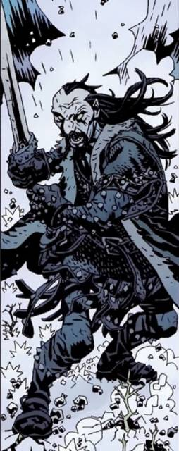

**Koshchei**, often referred to as "Koshchei the Deathless" or "Koshchei the Devil," is a figure from Slavic folklore and a one time foe of [Hellboy](/entry/Hellboy%20%28character%29).

## History

In the Hellboy Universe he is a slave of [the Baba Yaga](/entry/Baba%20Yaga%20%28character%29). He is quite literally deathless as he cannot be killed due to his soul being separate from his body. After being killed and having is corpse chopped to pieces and left in the woods, a [dragon](/entry/The%20Dragon) that had watched over him for years revived Koshchei through magic. To ensure that this would never happen again, the Dragon took Koshchei's soul from his body and hid it away inside of an egg, inside of a duck, inside of a rabbit, inside of a goat, inside of a tree, on an island just beyond the edge of the world. Baba Yaga is said to have "hidden the goat" and holds it hostage so Koshchei will do her bidding, in hope that the Baba Yaga will one day release his soul and allow him to die, as Koshchei has become tired of immortality.

He was conymtracted by Baba Yaga to kill Hellboy who was trapped in the Thrice Lands.

Later he appeared in the *[How Koshchei Became Deathless](/entry/How%20Koshchei%20Became%20Deathless)*, a back-up feature in *[Hellboy: The Wild Hunt](/entry/The%20Wild%20Hunt)*. In late 2015, Mike Mignola announced he was working on a [*Koshchei the Deathless* miniseries](http://spidermedia.ru/comics/hellboymedia-exclusive-mike-mignola-russia-interview). Koshcei appears to have died and sent to Hell. He is seen in a bar with Hellboy sharing a couple of drinks. Despite their past Koshcei holds no grudges toward Hellboy and shares his past to the paranormal investigator.

**Category:Characters** **Category:Male Characters** **Category:Deceased Characters** **Category:Undead** **Category:Immortals**