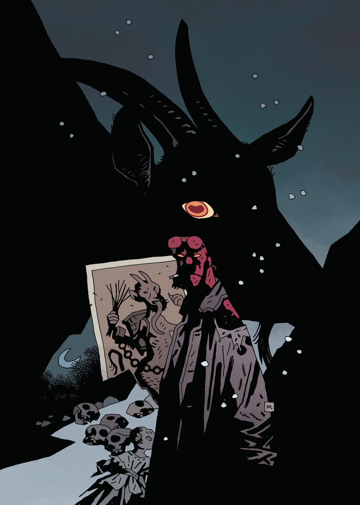

***Krampusnacht*** is a one-shot winter special. It won the [Eisner Award](https://www.comic-con.org/awards/eisner-awards-current-info) for Best Single Issue / One-Shot in 2018.

## Publication History

This is the third [winter special](/entry/Hellboy%20Winter%20Special). Unlike the previous two, this is not a collection of shorter stories, but rather a one-shot story. This issue marks [Adam Hughes's](/entry/Adam%20Hughes) debut on the Hellboy Universe books. The story is set in 1975, the same year as the Christmas in the short story *[Mood Swings](/entry/Mood%20Swings)*.

## Christmas Memories

In the original *Hellboy: Krampusnacht* issue, there was a section in the back titled "Christmas Memories". It featured a collection of three pinups done in the style of photographs from Christmases of [Hellboy](/entry/Hellboy%20%28character%29)'s past.

文件:Christmas 1946.jpg|"Christmas, 1946 - I got a Lobster Johnson decoder ring!" 文件:Christmas 1995.jpg|"Christmas, 1995 - The year Abe got drunk!" 文件:Christmas Alice.jpg|"Alice"

## Gallery

文件:Krampusnacht AdamHughes.jpg|Adam Hughes cover 文件:Krampusnacht MikeMignola.jpg|Mike Mignola variant cover 文件:Krampusnacht Incentive.jpg|Incentive variant cover

## External Links

["Christmas Memories" on BloodyDisgusting.com](http://bloody-disgusting.com/comics/3475363/exclusive-hellboy-shares-christmas-memories-hellboy-krampusnacht-images/)

**Category:Story** **Category:Hellboy story**