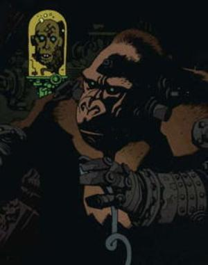

The **Kriegaffe** ("Kriegaffen" meaning 'war apes' in German) were a series of mentally and physically enhanced apes created by Nazi scientist [Herman von Klempt](/entry/Herman%20von%20Klempt). Most Kriegaffen can be seen with cybernetic arms and metallic appendages on their heads.

## Known Kriegaffen

### Mukali

Mukali is a precursor of the Kriegaffe that appeared in *[Get the Lobster!](/entry/Get_the_Lobster!))*. It is owned by [Niels Waxman](/entry/Niels%20Waxman). Mukali was sent to attack [The Lobster](/entry/The%20Lobster) but was killed when The Lobster stabbed a knife into its head and shorting out its rewired brain.

### Kriegaffe \#2

Kriegaffe \#2 along with another Kriegaffe appears in *[B.P.R.D.: 1946](/entry/1946)*. They were killed by Professor [Trevor Bruttenholm](/entry/Trevor%20Bruttenholm)'s early [B.P.R.D.](/entry/Bureau%20for%20Paranormal%20Research%20and%20Defense) team and Soviet soldiers of the [Special Sciences Service](/entry/Special%20Sciences%20Service).

### Kriegaffe \#9 (Brutus)

During the events of [World's Greatest Paranormal Investigator (CBG)](/entry/World%27s%20Greatest%20Paranormal%20Investigator%20%28CBG%29), Herman von Klempt and his Kriegaffe \#9 (whom had been dubbed Brutus) had been hiding out in a castle, and performing experiments on kidnapped peasant girls. The duo was stopped by [Hellboy](/entry/Hellboy) when he interrupted one of their experiments. In the ensuing battle, Hellboy destroys Brutus' hands, and dies when Hellboy burns down the castle in the process of rescuing von Klempt's last surviving victim.

### Kriegaffe \#10

A tenth Kriegaffe appears in the *[Conqueror Worm](/entry/Conqueror%20Worm%20%28story%29)* story arc aiding von Klempt and [Inger von Klempt](/entry/Inger%20von%20Klempt) in their attempt to unleash the [Conqueror Worm](/entry/Conqueror%20Worm). After von Klempt captures Hellboy, Kriegaffe \#10 repeatedly tortures him until the bases power shuts off, and Hellboy defeats the brute. Kriegaffe \#10 attacks Hellboy again, but is defeated, and killed.

Years later, the skeleton of this Kriegaffe was discovered by [Kate Corrigan](/entry/Kate%20Corrigan) and [Bruno Karhu](/entry/Bruno%20Karhu) while returning the spirit of [The Lobster](/entry/The%20Lobster).[1]

## Trivia

- Although Kriegaffe is technically German for 'war ape', **K**rieg**s**affe is grammatically correct.

<!-- -->

- The [Unmensch](/entry/Unmensch) had similar cybernetic limb replacements as the Kriegaffen.

## Sources

<references/>

**Category:Nazi** **Category:Characters** **Category:Species** **Category:villains**

[1] *[King of Fear](/entry/King%20of%20Fear%20%28story%29)* \#2