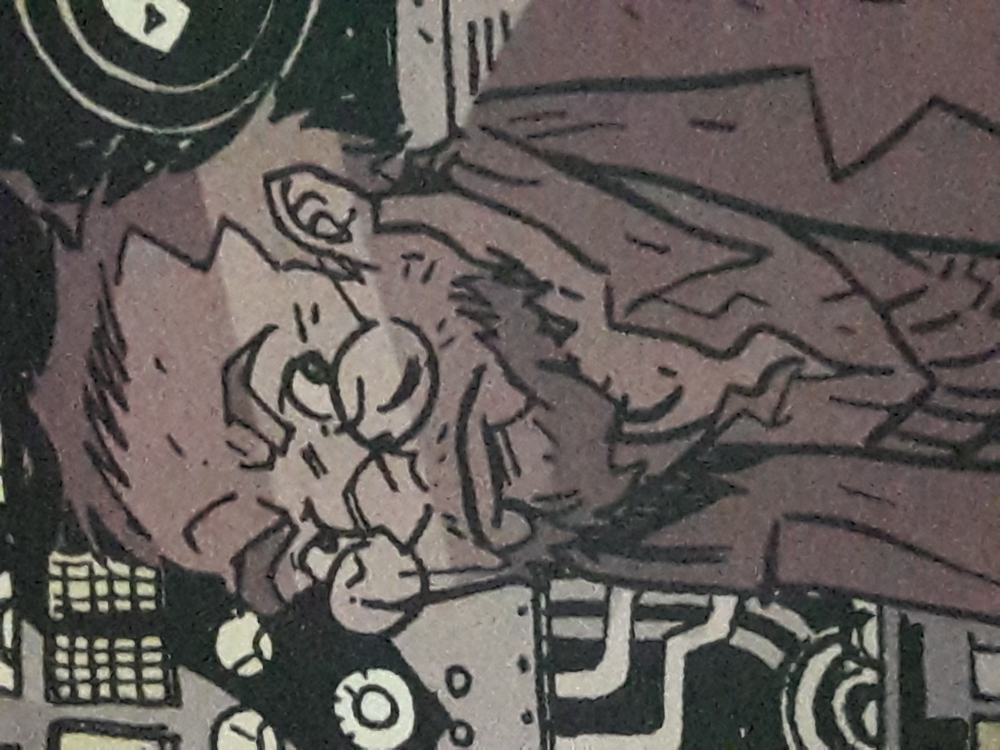

Professor **Kyriakos Gallaragas** was a scientist who created the [Vril Energy Suit](/entry/Vril%20Energy%20Suit) and Anum's Fork.

## History

Professor Gallaragas created the V.E.S. (Vril Energy Suit) in an attempt to harness the power of [Vril](/entry/Vril) which was previously used by the Hyperboreans and tested the suit on [Jim Sacks](/entry/Jim%20Sacks). Soon after the suit was completed, the suit attracted the attentions of Axis agents and later the enigmatic man [Memnan Saa](/entry/Memnan%20Saa) (whom Gallaragas referred to him as "The Devil"). He and his daughter Helena were captured by Saa, but the V.E.S. suit was safely taken away by Sacks.

In an attempt to literally drag the information out of him, Saa's followers cut out Gallaragas' brain and wired it to their machines. The professor's brain was later discovered by Sacks, which Gallaragas revealed him about Saa's intentions on using Vril, but is then shot by Saa to prevent any more information about his plans being exposed. However, in death, the spirit of Gallaragas advised Sacks, who had transcended from the Vril power into a super-being that the professor had expected, from which Sacks used his newfound powers in foiling Saa's plans.

## Legacy

In the 1950s, Professor Gallaragas's work was studied in a military base in Colorado. The facility was closed in 1962. In October 2004, the facility became the new headquarters for the [Bureau for Paranormal Research and Defense](/entry/Bureau%20for%20Paranormal%20Research%20and%20Defense).

**Category:Characters** **Category:Male Characters** **Category:Scientists** **Category:Lobster Johnson Characters** **Category:Deceased Characters** **Category:Spirits**