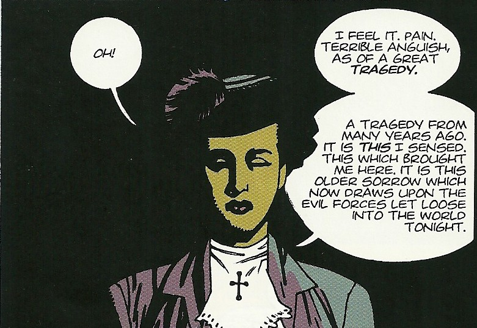

**Lady Cynthia Eden-Jones** was a psychic and ally of Professor [Trevor Bruttenholm](/entry/Trevor%20Bruttenholm).

## History

Lady Cynthia was formerly a famous clairvoyant in service to the British Paranormal Society.

### *[Hellboy:Seed of Destruction](/entry/Seed%20of%20Destruction)*

Lady Cynthia Eden-Jones appeared alongside Professor Trevor Bruttenholm, [Malcolm Frost](/entry/Malcolm%20Frost), and U.S. military official [George Whitman](/entry/George%20Whitman) during the "[Hellboy incident](/entry/Seed%20of%20Destruction)". She was present when a small demon suddenly appeared, claiming it looked like "a little boy". Unaware that she was about to name the creature, Bruttenholm then followed up on this, by saying "[Hell boy](/entry/Hellboy)".

### *[Hellboy and the B.P.R.D.: 1954—Ghost Moon](/entry/Ghost%20Moon)*

By 1953, she was working under the [Special Intelligence Directorate](/entry/Special%20Intelligence%20Directorate). When one of her agents went rogue, she contacted Professor Bruttenholm to ask the B.P.R.D. to assist under the ruse that she wished to acquire a artifact in Hong Kong.

But, this was not their last encounter. In 1961, Hellboy met her again shortly before she died.

**Category:Characters** **Category:Female Characters** **Category:Humans** **Category:Psychics** **Category:Deceased Characters** **Category:British** **Category:Hellboy characters**