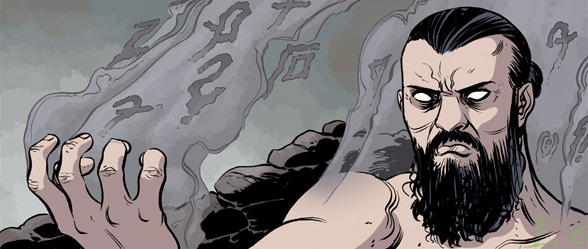

 **Dr. Lazar** was a research technician working for the [Special Sciences Service](/entry/Special%20Sciences%20Service).  While working for the S.S.S. Lazar became infected by the spirit of an Ogdru Hem.

## [Russia](/entry/Russia)

Lazar is first seen in the B.P.R.D. miniseries: *Russia*.  He is part of a crew of scientists studying former S.S.S. Commander of Esoteric Teachings Division, Nicholas Verlacz, a medium who had been possessed by the spirit of an Ogdru Hem. Lazar and his fellow scientists were unhappy with their treatment by S.S.S. director [Iosif Nichayko](/entry/Iosif%20Nichayko).  After Nichayko killed the possessed Verlacz, Lazar and the others began to plan some sort of rebellion against Nichayko and agreed to meet later in an isolated farmhouse somewhere in the Russian countryside.

Fortunately for Lazar, his car broke down on his way to the meeting.  He arrived in time to see Nichayko exiting the burning farmhouse after executing Lazar's colleagues.  The scientists apparently had some sort of loyalty or tie to the imprisoned demon and former S.S.S. director [Varvara](/entry/Varvara).  They were also revealed to be infected by Ogdru spirits.

## [The Return of the Master](/entry/The%20Return%20of%20the%20Master)

Lazar is first seen arriving at a ferry terminal in Northwick, Scotland.  He is apparently the only person to come into Scotland from Norway due to the massive storm that destroyed much of England. While coming into the terminal he had some sort of effect on the drug-sniffing dogs used by the Scottish authorities, causing them to grow monstrous and attack civilians. Lazar enters and exits the terminal silently as the huge crowd of people rushes to flee from the monstruous dogs.

Lazar is seen again in a ruined castle in the Scottish highlands. He is being labeled a "messiah" and has gathered a small cult around him. While his followers prepare defenses for the castle Lazar carves symbols into his torso and left arm. Lazar warns his people that "assassins" would come to stop them and tells them to prepare for an attack.  While speaking, he causes a snake on the ground to sprout dozens of crustacean-like legs and declares the animal to be a "weapon" and a "warrior".  Due to a warning by S.S.S. director Nichayko, [B.P.R.D.](/entry/B.P.R.D.) forces led by Agent [Carla Giarocco](/entry/Carla%20Giarocco) and Agent Sal Tasso attempt to find Lazar and his people, but he is able to slow them down by sending dozens of mutated animals to attack them.  During this time he goes into a meditative trance; one of his people claims that he "isn't here."  While in this trance, Lazar's eyes are bigger and filled with some sort of black energy.  He is somehow able to enter Vigrid field, where [Nimue](/entry/Nimue)'s army of the dark was defeated by the noble dead of Britain (as seen in Hellboy: [The Fury](/entry/The%20Fury)).  Using magic, Lazar is able to summon forth the dead giants of Nimue's army to fight for him against the encroaching B.P.R.D. forces.

Lazar is then seen sitting calmly with his mutated snake drapped around him while his followers and undead giants engage the B.P.R.D. in battle.  One of his followers reports that they are dying, but he replies that this is good and tells them to keep dying.  The ruined castle is then destroyed with Lazar inside and his cult begins to despair before Lazar bursts through the rubble.  He rallies his forces, claiming that every death only makes him stronger; his snake mutates further growing larger.  He is able to causes the High Explosive rounds to explode in the Bureau's guns, killing and wounding a few B.P.R.D. agents, including Agent Tasso.  He is seen standing triumphantly as the souls of the dead  and his snake monster swirl around him.

When his forces appear to be on the brink a victory a massive earthquake shakes and cracks the land.  This earthquake is brought on by the revival of [the Black Flame](/entry/The%20Black%20Flame%20%28character%29) by the [Zinco Corporation](/entry/Zinco%20Corporation). One of these cracks appears directly below Lazar and explodes under his feet, killing him. His undead giants fall apart at his death and the remnants of his forces flee.

## Abilities

The full extent of Lazar's power is unknown, with much of it seemingly derived from the writing carved onto his body.  He is able to draw strength and power from the deaths of his followers, and proved capable of entering Vigrid field and summoning forth some of the dead army there to fight for him. Additionally, he showed abilities similar to an Ogdru Hem, such as rapidly mutating animals into vicious monsters, and warping lingering spirits to his whim.

## Connection with Rasputin

Throughout the Return of the Master there are several hints that Lazar is channeling the spirit of the dead Russian mystic, [Grigori Rasputin](/entry/Grigori%20Rasputin).  It is currently unknown if Lazar was in connection with Rasputin's spirit, or if his power and change in character was the result of of his infection by the Ogdru Hem spirits.  Before his death, it was clear he was no longer loyal to Varvara, but it is unknown if he was working to advance the plans of the Ogdru Hem or he had some other goal.

**Category:Characters** **Category:Male Characters** **Category:Deceased Characters** **Category:Russians** **Category:Scientists** **Category:The Ogdru Jahad and their Agents** **Category:Villains**