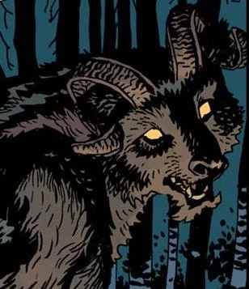

**Leshii** is a Russian spirit of the forest and a enemy of [the Baba Yaga](/entry/Baba%20Yaga%20%28character%29).

## History

In *[Koshchei the Deathless](/entry/Koshchei%20the%20Deathless%20%28story%29)*, Leshii is encountered by Koshcei and his band on their quest to slay the dragons. He spoke to Koshchei, warning that he knew it was Baba Yaga that sent him on this quest. Leshii agreed that the dragons needed to be stopped as they would be a threat to both man and beast. However he warned him that Baba Yaga may be using him for her own ends. The god guided Koshchei to their next comrade, but also warned him not to harm any of the creatures of the forest.

Leshii lives in the dreamscape of fairy tale Russia, where he is at odds with Baba Yaga. When [Hellboy](/entry/Hellboy%20%28character%29) was forcibly taken to Baba Yaga's realm, Leshii decided to assist the demon-spawn out of spite for the witch. Summoning his wolves, they made short work of the witch's undead warriors. He gave Hellboy one night of sanctuary in his forest and called upon [Perun](/entry/Perun) to bring a storm to weather Baba Yaga's army.

## Powers & Abilities

Leshii is a shapeshifter capable of taking the form of an old man or a massive horned bear. He also has under his command a pack of giant wolves. When Leshii was young he strong enough to fight against dragons.[1]

## References

<references />

**Category:Characters** **Category:Male Characters** **Category:Deities** **Category:Immortals**

[1] *[Koshchei the Deathless](/entry/Koshchei%20the%20Deathless%20%28story%29)* Issue 2