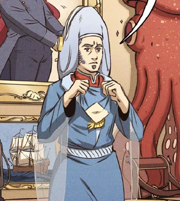

**Lord Hodgson** was the leader of the [Oannes Society](/entry/Oannes%20Society) during the 19th century.

## History

In November 1834, Lord Hodgson held a ceremony in dedication to Oannes at his estate ii Stanton Harcourt, Oxfordshire, England. In attendance was the newly American initiate Langdon Everett Caul. Hodgson was interested in the young man due to Dr. Netaunt's recommendation, and also his personal relationship with Elihu Cavendish. Cavendish had traveled the world, seeking out on nautical lore. Hodgson hoped that Caul had gleamed any secrets from the captain, sadly the former sailor had nothing to note save a theory that a prehuman civilization existed beneath the polarian ice. Hodgson attempted to learn more but Caul was unable to provide exact coordinates as he believed Caul to be a mad drunk. Despite his disappointment Hodgson encouraged to seek out answers and reminded him of the Society's purpose: to seek out humanity;s origins.

He tasked Caul to meet with one of the Oannes Society's sympathizers recovered a frozen specimen that may provide evidence to further the Scoiety's cause.

**Category:Characters** **Category:Male Characters** **Category:Oannes Society**