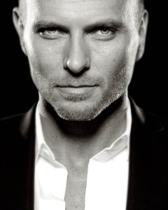

Luke-Goss-240x300.jpg

Actor/Producer/Writer/Musician

Luke Goss plays ‘Prince Nuada ’ in [Hellboy II: The Golden Army](/entry/Hellboy%20II%3A%20The%20Golden%20Army), [Guillermo del Toro’s](/entry/Guillermo%20del%20Toro) critically-acclaimed [Hellboy](/entry/Hellboy%20%28film%29) sequel that opened in the number one spot atop the U.S. box office this July. A role that earned him 2 MTV Movie Award nominations. He recently completed the starring role in Tekken, a sci-fi feature thriller based on the popular video and arcade game. He has just been attached to play ‘Kristoff,’ in a big screen adaptation of the Top Cow comic book, Magdalena, being developed and produced by Gale Anne Hurd’s Valhalla Pictures, Platinum Studios and Top Cow.

Goss has recently completed filming his first role for Network Television in JJ Abrams “Fringe”

Goss started his acting career playing ‘Danny Zuko’ in the smash hit musical Grease, on London’s West End, and later toured with the production throughout the United Kingdom.

He established himself as a screen actor in 2002 with performances in two very different features: David Goyer’s independent drama ZigZag, with John Leguizamo, Oliver Platt, Natasha Lyonne and Wesley Snipes; and Guillermo Del Toro’s supernatural action feature Blade II, with Snipes and Ron Perlman. The following year, he starred in the title role of the critically-acclaimed British gangster film Charlie, and in the title role in the Emmy Award-winning Hallmark miniseries Frankenstein, with Donald Sutherland and William Hurt.

In 2005, Goss traveled to India for the title role in the Biblical epic One Night With The King, opposite Omar Sharif and Peter O’Toole. Recent film credits also include The Man, with Samuel L. Jackson and Eugene Levy; Mercenary, with Steven Seagal; Bone Dry, with Lance Henriksen; Unearthed, with Emmanuelle Vaugier; Deep Winter, with Michael Madsen; and Shanghai Baby, with Bai Ling.

In the late 1980s and early Goss was a member of the band Bros along with his brother Matt and friend Craig Logan.

**Category:Real people**