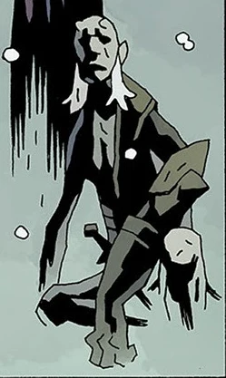

**Lusk** was the scheming and jealous brother of [Hellboy](/entry/Hellboy). He and his brother [Gamon](/entry/Gamon) were tricked by their uncle [Astaroth](/entry/Astaroth) into fighting Hellboy for the [Right Hand of Doom](/entry/Right%20Hand%20of%20Doom). When Astaroth decapitated Gamon for insulting their father, Lusk realized his uncle's deceitful nature and likely intentions.

As Lusk argued with Astaroth, the [Leviathan](/entry/Leviathan) rose and devoured them, along with Gamon's dismembered body.

**Category:Demons** **Category:Characters** **Category:Male Characters** **Category:Deceased Characters**