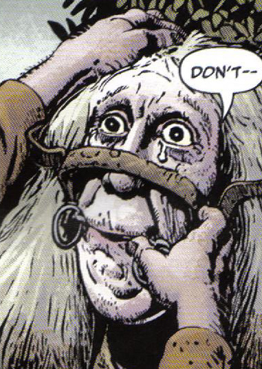

The Magic horse's bit and bridal is a cursed item encountered by Hellboy and [Tom Ferrell](/entry/Tom%20Ferrell) in [The Crooked Man](/entry/The%20Crooked%20Man). [Effie Kolb](/entry/Effie%20Kolb) had put this on Tom's father and literally rode him to death.

Tom kept the bit though and when the opportunity presented itself put it on the vile woman as a punishment for her crimes.

## Powers and abilities

If you put this cursed item on someone then they turn into a horse. Unable to remove it themselves a victim is doomed to chew grass and be ridden until someone removes it. It does seem to translate the victim's emotional outbursts and attempts at speech into a horsey equivalent.

**Category:Items**