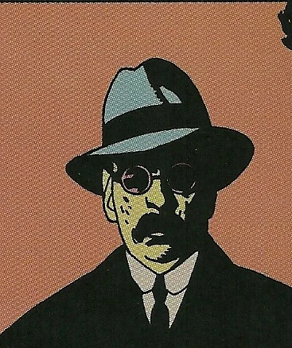

**Malcolm Frost** was a paranormal expert who was present at the ["Hellboy Incident"](/entry/Seed%20of%20Destruction) and urged for the death of [Hellboy](/entry/Hellboy) due to his role in the end of the world.

## History

Malcolm Frost was a one of three paranormal experts assembled by Sergeant [George Whitman](/entry/George%20Whitman) in 1944. and present during the ["Hellboy Incident"](/entry/Seed%20of%20Destruction). Among these specialists were also [Trevor Bruttenholm](/entry/Trevor%20Bruttenholm), [Lady Cynthia Eden-Jones](/entry/Lady%20Cynthia%20Eden-Jones), and [The Torch of Liberty](/entry/The%20Torch%20of%20Liberty). After seeing the young [Hellboy](/entry/Hellboy) come to Earth, Frost immediately orders Sgt. Whitman to shoot down the creature, but Eden-Jones and Bruttenholm protected the child.

In 1945, Professor Frost began to travel as part of his research. For the next eight years, Frost would make numerous attempts to have Hellboy destroyed. But when the government gave Hellboy human status, Frost was crushed. He died shortly thereafter, committing suicide.[1]

## Other Media

Frost was briefly seen in the [Hellboy Animated](/entry/Hellboy%20Animated) film *Blood and Iron* during two flashback scenes. The first of Hellboy's appearance on earth, where Frost thought that the creature should have been killed. The Second at the end of the movie where Frost tells [Trevor Bruttenholm](/entry/Trevor%20Bruttenholm) that he does not have to face the vampire alone. In the scene a scrap of parchment like that from "[The Right Hand of Doom](/entry/The%20Right%20Hand%20of%20Doom)" can been seen.

## Sources

<references/>

**Category:Characters** **Category:Minor Character** **Category:Deceased Characters** **Category:Occultists** **Category:Male Characters** **Category:Humans**

[1] "[The Phantom Hand](/entry/The%20Phantom%20Hand)"