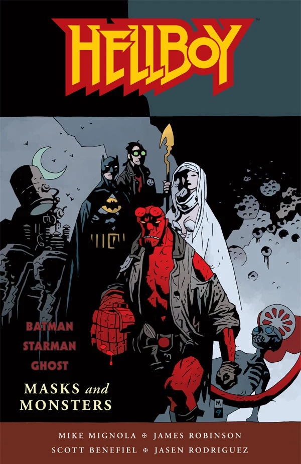

***Masks and Monsters*** is a [trade papberback](/entry/Trade%20Paperback%20Collections) published by Dark Horse Comics containing two previously published, non-canonical [Hellboy](/entry/Hellboy) crossover stories, [Batman/Hellboy/Starman](/entry/Batman_Hellboy_Starman) and [Ghost/Hellboy](/entry/Ghost_Hellboy).

## Publisher's Summary

*[Mike Mignola](/entry/Mike%20Mignola) teams up with an all-star lineup of superhero creators to bring you two incredible crossover tales! First, Hellboy joins forces with Batman and Starman in an adventure that takes them from the rooftops of Gotham to the steamy jungles of the Amazon, to rescue the first Starman, Ted Knight, from a secret Nazi organization that plans to use him to resurrect an elder god. Next, Hellboy travels to Arcadia in search of Ghost, a spectral vigilante caught up in a web of intrigue orchestrated by an ancient mask.*

## Issues Collected

- *[Batman/Hellboy/Starman \#1](/entry/Batman_Hellboy_Starman)*
- *[Batman/Hellboy/Starman \#2](/entry/Batman_Hellboy_Starman)*
- *[Ghost/Hellboy \#1](/entry/Ghost_Hellboy)*
- *[Ghost/Hellboy \#2](/entry/Ghost_Hellboy)*

## Additional Materials

The trade paperback also contains a six page annotated sketchbook about the making of Ghost/Hellboy. Additionally, the trade paperback contains a pin-up of the French version of the *Ghost \#5* cover by Claire Wendling.

## External Links

[*Masks and Monsters* product page on DarkHorse.com](https://www.darkhorse.com/Books/17-181/Hellboy-Masks-and-Monsters-tpb%7C)

**Category:Comics**