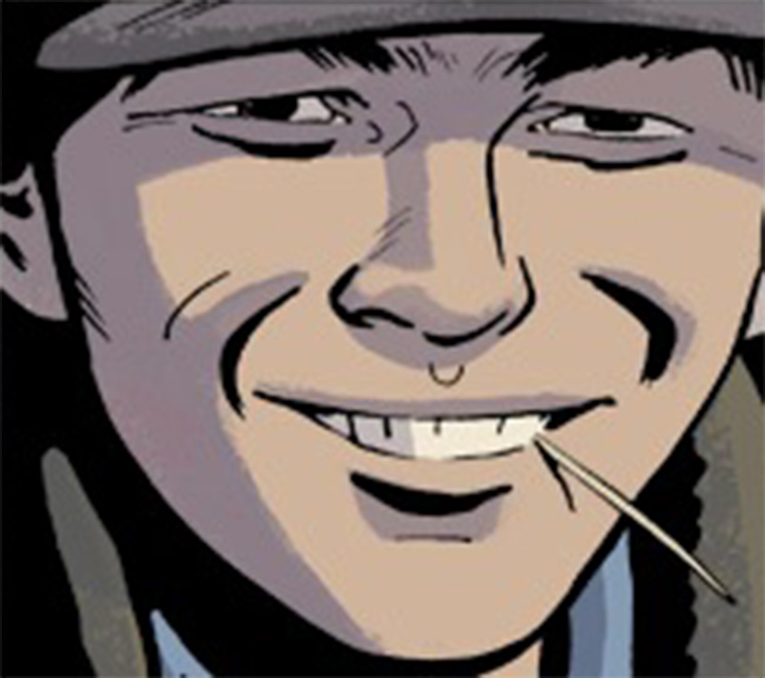

**Massimo** (a.k.a. Max) was a member of [Lobster Johnson](/entry/Lobster%20Johnson)'s group of vigilantes. Though he only had one appearance and was summarily killed, It appears he was a valued member of the group.

He had not yet paid off his new cab when he died, but appearantly he could drive well and carried a Thompson Machine Gun. Sadly enough it did not protect him from the original [Black Flame](/entry/The%20Black%20Flame%20%28character%29) who burnt him and took his corpse for information. The wife of the Black Flame then preformed a ritual that allowed her to absorb Massimo's knowledge of the Lobster's hideout. Hence the subsequent attack on the compound had more succes than it would've had otherwise. Massimo was missed in particular by [Harry McTell](/entry/Harry%20McTell).

## Trivia

- Due to his rapid departure from life following his introduction Massimo can be considered to be the series equivalent of a  Red Shirt character.

**Category:Lobster Johnson Characters** **Category:Characters** **Category:Lobster's crew**