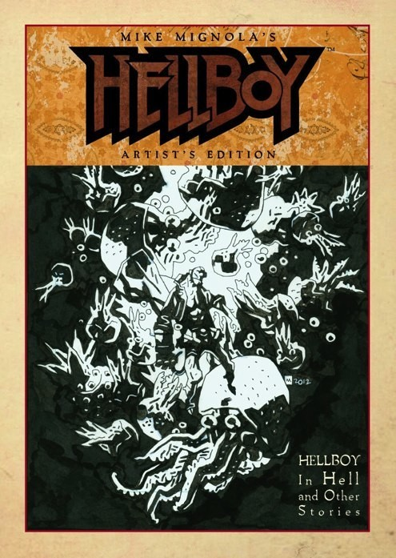

## Publication History

**Mike Mignola's *Hellboy* Artist's Edition** collects *[Hellboy in Hell](/entry/Hellboy%20in%20Hell)* \#1-5, [the four-page teaser from *San Diego Comic Con Comics* \#2 (1993)](/entry/World%27s%20Greatest%20Paranormal%20Investigator%20%28SDCC%29), [the four-page teaser from *The Comic Buyer's Guide* \#1070 (1994)](/entry/World%27s%20Greatest%20Paranormal%20Investigator%20%28CBG%29), Mike Mignola's pages from [John Bryne's](/entry/John%20Byrne) *Next Men* \#21 (1993), *[The Corpse](/entry/The%20Corpse)* (1995), and two other stories.

Published by IDW, the stories are presented with all but three pages scanned from the original art, with the black and white page printed in color to mimic as closely as possible the experience of viewing the actual original art. Each page is printed the same size as drawn, and the paper selected is as close as possible to the original art board.

The book collects:

- [*Hellboy in Hell* \#1-4](/entry/Hellboy%20in%20Hell%20%28first%20story%20arc%29)
- [*Hellboy in Hell: The Three Gold Whips*](/entry/The%20Three%20Gold%20Whips)
- [Mike Mignola's *Hellboy*](/entry/World%27s%20Greatest%20Paranormal%20Investigator%20%28SDCC%29)
- [Mike Mignola's *Hellboy: World's Greatest Paranormal Investigator*](/entry/World%27s%20Greatest%20Paranormal%20Investigator%20%28CBG%29)
- *Faith*, an excerpt from John Byrne's *Next Men* \#21
- *[The Corpse](/entry/The%20Corpse)*
- [*The Ghoul*, or, *Reflections on Death and the Poetry of Worms*](/entry/The%20Ghoul)
- [*The Troll-Witch*](/entry/The%20Troll%20Witch)

The *Hellboy in Hell* stories are unlettered, as the lettering was done digitally for these stories.

There are three pages that could not be scanned for this volume. They are page 16 from *Hellboy in Hell* \#2, and pages 7 and 19 from *The Corpse*. They are presented as uncolored back and white scans.

## Gallery

文件:Hellboy Artist's Edition.jpg|1st Edition cover 文件:Hellboy Artist's Edition - SDCC Exclusive.jpg|San Diego Comic Con 2014 exclusive cover 文件:Hellboy Artist's Edition - 2nd Edition cover.jpg|2nd Edition cover

**Category:Comics**